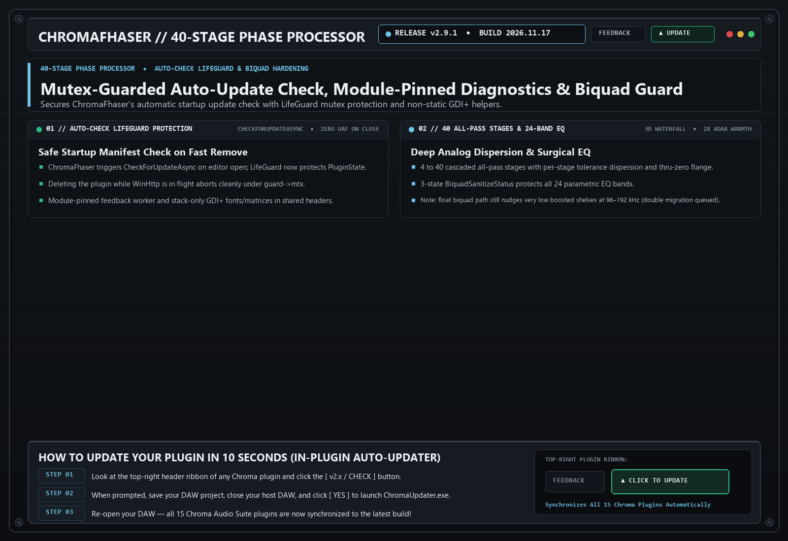

# ChromaFhaser `v2.9.1` — Release Notes (2026-11-17)

**[⬅ Back to ChromaFhaser Overview & Glossary](./README.md)**

## LifeGuard Startup Update Check, Module-Pinned Diagnostics & 3-State Biquad Guard

### What Changed & Why It Matters Musically

- **`LifeGuard`-Protected Startup Update Check**: Secures `CheckForUpdateAsync()` on editor open with mutex-guarded lifetime checks so closing or removing the plugin mid-request never touches freed memory.
- **3-State `BiquadSanitizeStatus` & Module-Pinned Feedback Shield**: Upgraded biquad coefficient sanitization and pinned background diagnostic threads against `FreeLibrary` unload races.

---
### ⚡ How to Update in 10 Seconds
1. Click the **`[ v2.x / CHECK ]`** button in the top-right header bar of the plugin.
2. Close your DAW and click **`[ YES ]`** in the prompt to run `ChromaUpdater.exe`.
3. Re-open your DAW — you are now on the latest build!
