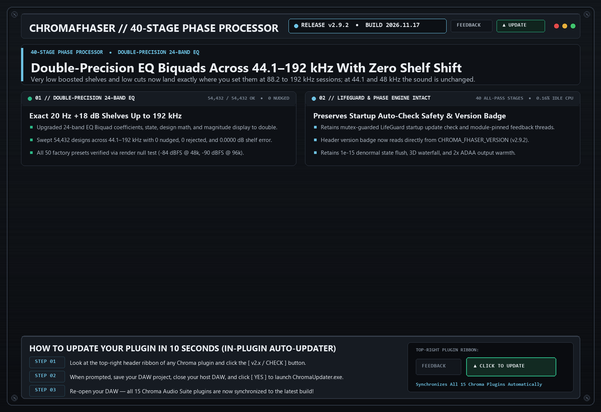

# ChromaFhaser `v2.9.2` — Release Notes (2026-11-17)

**[⬅ Back to ChromaFhaser Overview & Glossary](./README.md)**

## Double-Precision 24-Band EQ Biquads Across 44.1–192 kHz

### What Changed & Why It Matters Musically

- **Plain-English DSP Summary**: Very low boosted shelves and low cuts now land exactly where you set them at 88.2 to 192 kHz sessions; at 44.1 and 48 kHz the sound is unchanged.
- **Double-Precision EQ `Biquad`**: Moved coefficients, filter state, design math, and magnitude display to `double` with `1e-8` unit-circle sanitization (`54,432/54,432` designs `Ok`, `0` nudged, `0` rejected).
- **Verified 50-Preset Null & Header Version**: All 50 factory presets null to `-84 dBFS` (`48 kHz`) and `-90 dBFS` (`96 kHz`), and the in-plugin header now renders `v2.9.2`.

---
### ⚡ How to Update in 10 Seconds
1. Click the **`[ v2.x / CHECK ]`** button in the top-right header bar of the plugin.
2. Close your DAW and click **`[ YES ]`** in the prompt to run `ChromaUpdater.exe`.
3. Re-open your DAW — you are now on the latest build!
