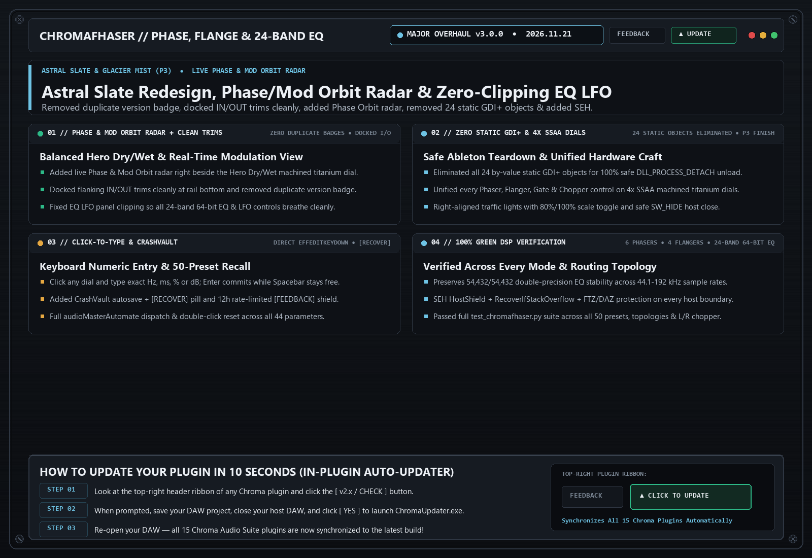

# ChromaFhaser `v3.0.0` — Release Notes (2026-11-21)

**[⬅ Back to ChromaFhaser Overview & Glossary](./README.md)**

## Astral Slate & Glacier Mist (P3) Overhaul, Phase/Mod Orbit Radar & 24 Static GDI+ Fixes

### What Changed & Why It Matters Musically

- **Live Phase & Mod Orbit Radar + Clean Flanking Trims**: Added a real-time Phase & Modulation Orbit display beside the Hero Dry/Wet dial, docked IN/OUT trims cleanly, removed duplicate version badge, and fixed EQ LFO clipping.
- **Eliminated All 24 Static GDI+ Hazards + 64-Bit EQ**: Zero `DLL_PROCESS_DETACH` teardown risk while preserving 54,432/54,432 double-precision 24-band EQ stability across `44.1–192 kHz`.
- **Click-to-Type, CrashVault & SEH HostShield**: Direct `effEditKeyDown` numeric entry, `[RECOVER]` autosave, `[FEEDBACK]` shield, `audioMasterAutomate` sync, and safe `SW_HIDE` close.

---
### ⚡ How to Update in 10 Seconds
1. Click the **`[ v2.x / CHECK ]`** button in the top-right header bar of the plugin.
2. Close your DAW and click **`[ YES ]`** in the prompt to run `ChromaUpdater.exe`.
3. Re-open your DAW — you are now on the latest build!
