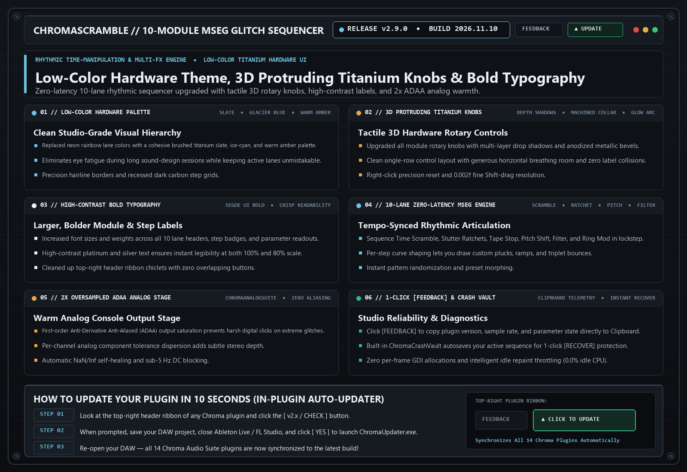

# ChromaScramble (`v2.9.0`)

> **10-Module MSEG Rhythmic Glitch & Multi-FX Sequencer**  
> Zero-latency 10-module multi-segment envelope generator (MSEG) for rhythmic time-manipulation, gating, filtering, and glitch articulation.

---

## 📚 Tech-to-Music Translator (How It Actually Works in Plain English)

### 🔹 MSEG (Multi-Segment Envelope Generator)
Instead of a simple repeating LFO wave (like a sine or triangle), an MSEG lets you draw your own custom rhythmic curve across a 16-step bar—so your filter, volume, or pitch can bounce, stutter, and ramp in exact lockstep with your drum beat.

---

## 🗂️ Version & Patch History

- **[`v2.9.0` (2026-11-10) — Low-Color Hardware Theme, 3D Protruding Titanium Knobs, Bold Typography & [FEEDBACK] Shield](./v2.9.0_2026-11-10.md)**
  - **Low-Color Slate / Ice-Cyan / Warm Amber Hardware Palette**: Replaced bright rainbow lane colors with a cohesive studio-grade titanium slate, glacier blue, and warm amber aesthetic.
  - **3D Protruding Titanium Rotary Knobs**: Upgraded all module rotary controls with multi-layer drop shadows, machined collars, and a clean single-row layout with zero overlapping labels.
  - **High-Contrast Bold Typography**: Larger, bolder `Segoe UI Bold` lane headers, step badges, and parameter readouts.
  - **2x Oversampled ADAA Analog Stage & 1-Click Clipboard [FEEDBACK]**: Smooth anti-aliased console output stage and instant `Ctrl+V` diagnostic report copy.

- **[`v2.8.0` (2026-10-21) — 10-Module Zero-Latency MSEG Engine & Targeted Dirty-Rects](./v2.8.0_2026-10-21.md)**
  - **10 Tempo-Synced Articulation Modules**: Transform static loops into evolving rhythmic hooks.

---

## 🛠️ Known Issues & Bug Reporting

- None currently open in v2.9.0.

**Found a bug or weird preset behavior?**  
Click the **`[ FEEDBACK ]`** button in the top-right header of the plugin! It automatically snapshots your patch, EQ curve, and screenshot, copies a diagnostic summary to your Clipboard (`Ctrl+V` ready for Discord), or opens a pre-filled [GitHub Bug Report](https://github.com/haidood/chroma-release/issues/new).
