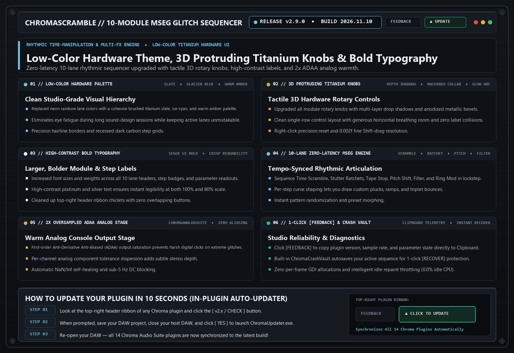

# ChromaScramble `v2.9.0` — Release Notes (2026-11-10)

**[⬅ Back to ChromaScramble Overview & Glossary](./README.md)**

## Low-Color Hardware Theme, 3D Protruding Titanium Knobs, Bold Typography & [FEEDBACK] Shield

### What Changed & Why It Matters Musically

- **Low-Color Slate / Ice-Cyan / Warm Amber Hardware Palette**: Replaced bright rainbow lane colors with a cohesive studio-grade titanium slate, glacier blue, and warm amber aesthetic.
- **3D Protruding Titanium Rotary Knobs**: Upgraded all module rotary controls with multi-layer drop shadows, machined collars, and a clean single-row layout with zero overlapping labels.
- **High-Contrast Bold Typography**: Larger, bolder `Segoe UI Bold` lane headers, step badges, and parameter readouts.
- **2x Oversampled ADAA Analog Stage & 1-Click Clipboard [FEEDBACK]**: Smooth anti-aliased console output stage and instant `Ctrl+V` diagnostic report copy.

---
### ⚡ How to Update in 10 Seconds
1. Click the **`[ v2.x / CHECK ]`** button in the top-right header bar of the plugin.
2. Close your DAW and click **`[ YES ]`** in the prompt to run `ChromaUpdater.exe`.
3. Re-open your DAW — you are now on the latest build!
