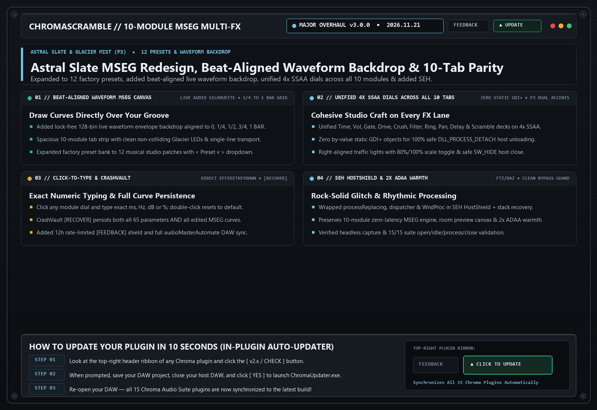

# ChromaScramble `v3.0.0` — Release Notes (2026-11-21)

**[⬅ Back to ChromaScramble Overview & Glossary](./README.md)**

## Astral Slate & Glacier Mist (P3) Overhaul, Beat-Aligned Waveform Backdrop & 12-Preset Bank

### What Changed & Why It Matters Musically

- **Beat-Aligned Live Waveform MSEG Canvas**: Displays a translucent live audio silhouette locked to `1/4`, `1/2`, `3/4`, and `1 BAR` behind every editable curve, plus an expanded 12-preset browser.
- **Spacious 10-Module Strip & Unified 4x SSAA Dials**: Non-colliding Glacier LEDs across all 10 tabs (`TIME` through `SCRAM`), single-line transport, and zero static GDI+ teardown hazards.
- **Full Curve CrashVault, Click-to-Type & SEH HostShield**: `[RECOVER]` saves both all 65 parameters and all MSEG curves; direct keyboard numeric entry, `[FEEDBACK]` shield, and safe `SW_HIDE` close.

---
### ⚡ How to Update in 10 Seconds
1. Click the **`[ v2.x / CHECK ]`** button in the top-right header bar of the plugin.
2. Close your DAW and click **`[ YES ]`** in the prompt to run `ChromaUpdater.exe`.
3. Re-open your DAW — you are now on the latest build!
