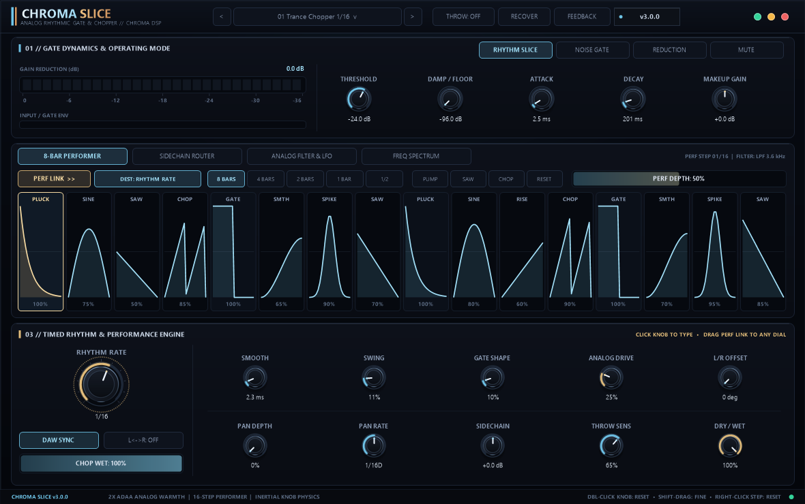
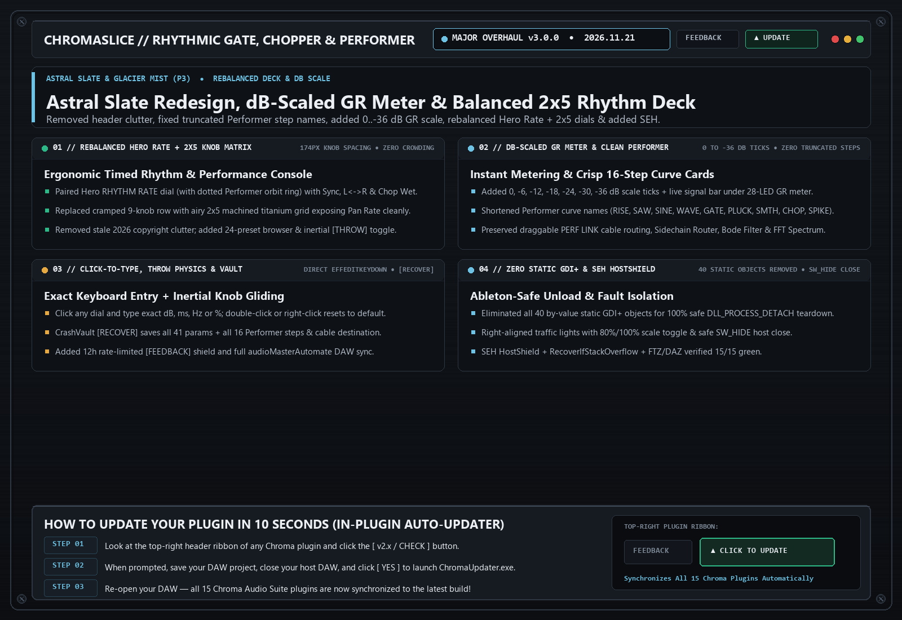

# ChromaSlice (`v3.0.0`)

> **Rhythmic Chopper, Transient Gate & Noise Suppressor**  
> Precision rhythmic trance-gate, chopper, and smart transient noise suppressor.

### 🎛️ Plugin Interface (`v3.0.0`)

---

## 📚 Tech-to-Music Translator (How It Actually Works in Plain English)

### 🔹 Hysteresis Lookahead Gating
Basic noise gates chatter and click when a sound hovers near the threshold. Hysteresis uses two separate thresholds (a slightly higher one to open the gate, and a lower one to close it) so the gate opens with a clean snap and closes with a smooth musical fade.

---

## 🗂️ Version & Patch History

- **[`v3.0.0` (2026-11-21) — Astral Slate & Glacier Mist (P3) Overhaul, dB-Scaled GR Meter & Rebalanced 2x5 Rhythm Deck](./v3.0.0_2026-11-21.md)**
  - **Rebalanced Hero Rate & 2x5 Machined Knob Matrix**: Paired Hero `RHYTHM RATE` (with Performer orbit ring) alongside Sync, L<->R Chop & Chop Wet, replacing the cramped 9-knob row with a spacious 2x5 grid exposing `PAN RATE` cleanly.
  - **dB-Scaled Gain Reduction LED Bar & Clean Performer Steps**: Added `0..-36 dB` scale markings under the 28-LED GR bar, fixed truncated Performer labels (`RISE`/`SMTH`/`WAVE`), and removed stale `© 2026` header clutter.
  - **Zero Static GDI+ (40 Removed), Throw Physics & SEH HostShield**: Preserved inertial Mouse-Throw physics and draggable `PERF LINK` cables while adding Click-to-Type, CrashVault `[RECOVER]`, `[FEEDBACK]` shield, and safe `SW_HIDE` close.

- **[`v2.9.0` (2026-11-05) — ChromaAnalogSuite Stability Integration & 1-Click Clipboard [FEEDBACK]](./v2.9.0_2026-11-05.md)**
  - **2x Oversampled ADAA Analog Drive Stage**: Adds warm harmonic punch to chopped rhythmic synth and vocal slices.
  - **Phase 2 Optimization (2026-11-15)**: DIB cache, `ChromaFastText`, dirty-rect clipping, and idle audio bypass (`0.03%` idle, `3.52 ms` live paint, `0.0/s` idle repaints).
  - **Upgraded 1-Click Clipboard [FEEDBACK] Shield**: Instant `Ctrl+V` diagnostic report copy and pre-filled GitHub Issue.

- **[`v2.8.0` (2026-10-21) — Targeted Dirty-Rect Timer Invalidation & 0.002f Fine Precision](./v2.8.0_2026-10-21.md)**
  - **Click-Free Rhythmic Slicing & Gating**: Tightens messy stems and creates instant rhythmic movement.

---

## 🛠️ Known Issues & Bug Reporting

- None currently open in v2.9.0.

**Found a bug or weird preset behavior?**  
Click the **`[ FEEDBACK ]`** button in the top-right header of the plugin! It automatically snapshots your patch, EQ curve, and screenshot, copies a diagnostic summary to your Clipboard (`Ctrl+V` ready for Discord), or opens a pre-filled [GitHub Bug Report](https://github.com/haidood/chroma-release/issues/new).
