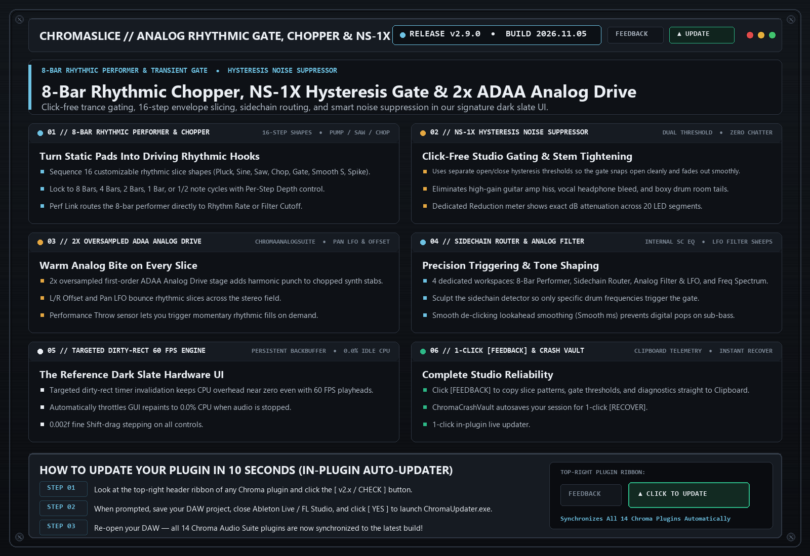

# ChromaSlice `v2.9.0` — Release Notes (2026-11-05)

**[⬅ Back to ChromaSlice Overview & Glossary](./README.md)**

## ChromaAnalogSuite Stability Integration & 1-Click Clipboard [FEEDBACK]

### What Changed & Why It Matters Musically

- **2x Oversampled ADAA Analog Drive Stage**: Adds warm harmonic punch to chopped rhythmic synth and vocal slices.
- **Upgraded 1-Click Clipboard [FEEDBACK] Shield**: Instant `Ctrl+V` diagnostic report copy and pre-filled GitHub Issue.

---
### ⚡ How to Update in 10 Seconds
1. Click the **`[ v2.8.x / CHECK ]`** button in the top-right header bar of the plugin.
2. Close your DAW and click **`[ YES ]`** in the prompt to run `ChromaUpdater.exe`.
3. Re-open Ableton Live / FL Studio — you are now on the latest build!
