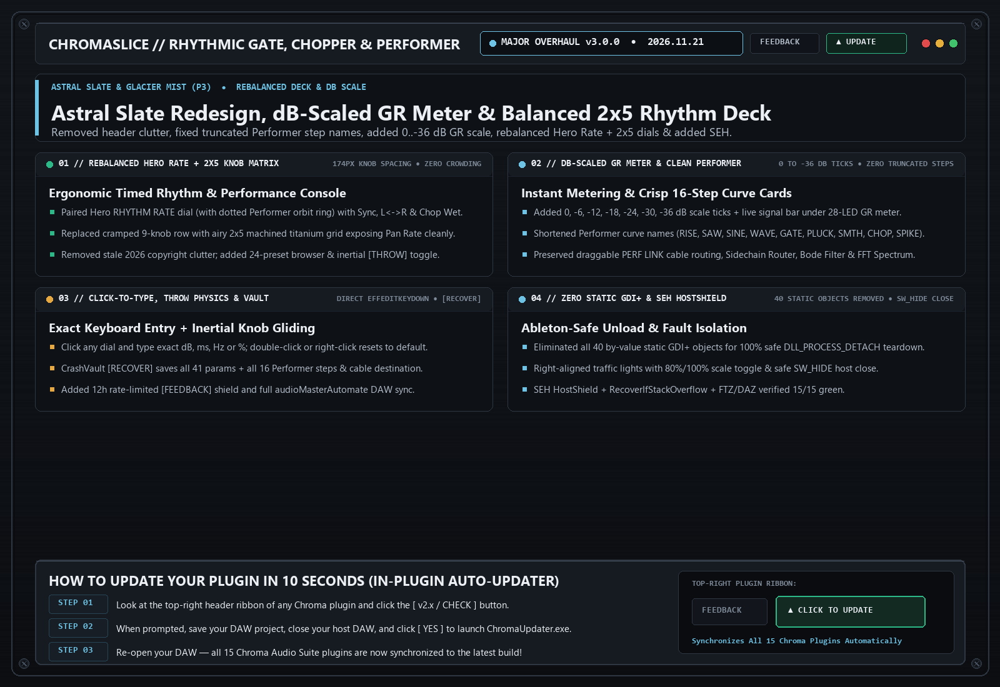

# ChromaSlice `v3.0.0` — Release Notes (2026-11-21)

**[⬅ Back to ChromaSlice Overview & Glossary](./README.md)**

## Astral Slate & Glacier Mist (P3) Overhaul, dB-Scaled GR Meter & Rebalanced 2x5 Rhythm Deck

### What Changed & Why It Matters Musically

- **Rebalanced Hero Rate & 2x5 Machined Knob Matrix**: Paired Hero `RHYTHM RATE` (with Performer orbit ring) alongside Sync, L<->R Chop & Chop Wet, replacing the cramped 9-knob row with a spacious 2x5 grid exposing `PAN RATE` cleanly.
- **dB-Scaled Gain Reduction LED Bar & Clean Performer Steps**: Added `0..-36 dB` scale markings under the 28-LED GR bar, fixed truncated Performer labels (`RISE`/`SMTH`/`WAVE`), and removed stale `© 2026` header clutter.
- **Zero Static GDI+ (40 Removed), Throw Physics & SEH HostShield**: Preserved inertial Mouse-Throw physics and draggable `PERF LINK` cables while adding Click-to-Type, CrashVault `[RECOVER]`, `[FEEDBACK]` shield, and safe `SW_HIDE` close.

---
### ⚡ How to Update in 10 Seconds
1. Click the **`[ v2.x / CHECK ]`** button in the top-right header bar of the plugin.
2. Close your DAW and click **`[ YES ]`** in the prompt to run `ChromaUpdater.exe`.
3. Re-open your DAW — you are now on the latest build!
