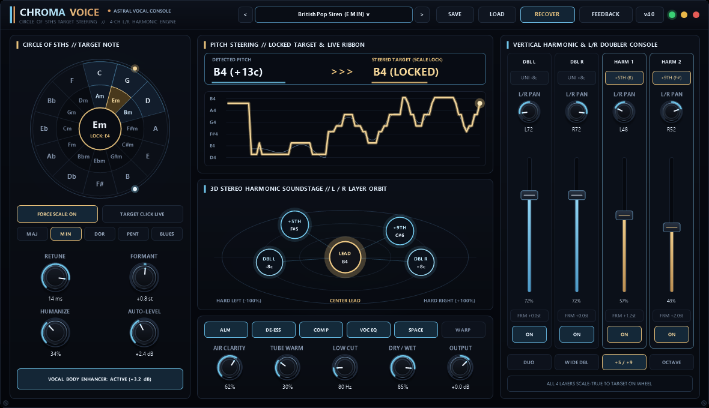

# ChromaVoice (`v4.0.0`)

> **Solar Monolith Orbit Vocal Pitch, Formant & 4-Channel Harmony Engine**  
> Real-time vocal pitch steering, formant shaping, and 4-channel L/R harmonic doubler console featuring a clickable Circle of 5ths Target-Note Wheel, Live Scrolling Pitch Ribbon, draggable 3D Stereo Harmonic Soundstage Orbit, +3.2 dB Weak-Vocal Body Enhancer, and non-ASIO DirectSound/WASAPI crackle-free playback.

### 🎛️ Plugin Interface (`v4.0.0`)

---

## 📚 Tech-to-Music Translator (How It Actually Works in Plain English)

### 🔹 Formants vs. Pitch (Why Chipmunk Vocals Happen)
When you sing a higher note, your vocal cords vibrate faster (Pitch), rapid-fire, but the size of your throat and mouth stays the same (Formants). Simple pitch shifters shrink the whole recording, making the singer's throat sound 3 inches long (the 'chipmunk' effect). Formant shifting lets you change the note while keeping the singer's natural chest and throat size intact—or morph a male vocal into a female or giant vocal at the same pitch!

### 🔹 Circle-of-5ths Live Target Steering & Scale-True Harmonies
Traditional pitch correction only pulls you toward the closest note. With Target Click Live on the Circle of 5ths wheel, clicking any note immediately steers a sung voice onto that exact target note—while all four harmony and stereo doubler layers (+5TH, +9TH, DBL L, DBL R) stay mathematically locked in tune with your chosen scale.

### 🔹 Consonant Micro-Windowing (Transient Preservation)
Granular pitch shifters smear sharp vocal 'S', 'T', and 'K' sounds across multiple grains, making vocals sound lispy or blurry. ChromaVoice detects sharp consonants in real time and automatically shrinks the grain window so every 'T' and 'K' stays crisp and upfront.

---

## 🗂️ Version & Patch History

- **[`v4.0.0` (2026-11-19) — Solar Monolith Orbit 1180x680 Redesign, Clickable Circle of 5ths Target Steering & 4-Channel L/R Harmonic Console](./v4.0.0_2026-11-19.md)**
  - **Solar Monolith Orbit 1180x680 Flagship UI**: Complete ground-up Solar Gold on Black Infinity reskin with 4x supersampled cached obsidian-gold machined dials, subtle cosmic starfield, and Retina `AntiAliasGridFit` typography.
  - **Clickable Circle of 5ths Target Wheel & 6 Scales**: Click any outer Major or inner Relative Minor wedge to lock key & scale (`Chromatic`, `Major`, `Minor`, `Dorian`, `Pentatonic`, `Blues`), or engage `TARGET CLICK LIVE` to steer sung vocals directly onto the clicked target note in real time with live sung vs. locked orbiting indicators.
  - **Hero Locked-Target Banner & Live 96-Frame Pitch Ribbon**: Real-time `DETECTED PITCH >>> STEERED TARGET (LOCKED)` telemetry paired with a glowing solar-gold scrolling pitch trace over the raw sung curve.
  - **Interactive 3D Stereo Harmonic Soundstage Orbit**: Visualize `LEAD`, `DBL L`, `DBL R`, `+5TH`, and `+9TH` layers in 3D stereo space—drag any orb horizontally for L/R pan and vertically for layer level, synced live with the vertical console.
  - **Full-Height 4-Channel Vertical Harmonic & L/R Doubler Console**: Dedicated studio strips for `DBL L`, `DBL R`, `HARM 1`, and `HARM 2` with scale-true interval cyclers (`UNI -8c/+8c`, `-OCT`, `SUB-5`, `+3RD`, `+5TH`, `+7TH`, `+9TH`, `+OCT`), rotary bipolar L/R pan knobs, machined vertical faders, formant offsets, `ON/OFF` toggles, and 1-click `DUO`, `WIDE DBL`, `+5 / +9`, and `OCTAVE` stack presets.
  - **+3.2 dB Weak-Vocal Body Enhancer, Studio FX Bay & Click-to-Type Knobs**: Instant 1-click vocal chest/body lift, 6 Studio FX toggles (`ALM`, `DE-ESS`, `COMP`, `VOC EQ`, `SPACE`, `WARP`), suite-standard Click-to-Type numeric entry on every knob, pan dial, and fader (`Spacebar` stays free), and full `CHROMAVOICE_V4` state chunk & CrashVault recall.

  **⌨️ Sequencer Hotkeys & Gestures:**

  | Key / Gesture | Action | Description |
  |---|---|---|
  | `Click Circle of 5ths Wedge` | **Lock Key / Target Note** | Sets key & scale in Force Scale mode, or steers vocals directly onto that target note in Target Click Live mode. |
  | `Drag 3D Soundstage Orbs` | **Visual L/R Pan & Level** | Drag DBL L, DBL R, +5TH, or +9TH orbs in 2D space to sculpt stereo width and balance synced to the vertical faders. |
  | `Click / Right-Click Interval Pill` | **Cycle Scale-True Interval** | Left-click cycles forward and right-click cycles backward across 9 scale-true doubler & harmony intervals. |
  | `Click Knob/Pan/Fader -> Type + Enter` | **Exact Numeric Value Entry** | Type exact values (e.g. -5 st, 14 ms, 120 Hz, -72 pan, 75% level) directly via keyboard; Esc cancels, Spacebar stays free. |
  | `Double-Click / Right-Click Knob` | **Reset to Studio Default** | Instantly snaps any knob or L/R pan dial back to its factory sweet-spot value. |

- **[`v3.3.1` (2026-11-19) — WARP Infinite-Loop Fix, Non-ASIO DirectSound/WASAPI Crackle Hardening & Pop-Free Preset Switching](./v3.3.1_2026-11-19.md)**
  - **Eliminated Critical WARP Audio-Thread Infinite Hang**: Fixed an unsigned `size_t` underflow (`writePos - 32`) when `writePos < 32` by introducing O(1) NaN-safe modular `wrapBufferPos()` across every WARP granular lookup and advance.
  - **Non-ASIO DirectSound / WASAPI Anti-Crackle Overhaul**: Moved diatonic harmony interval computation, `FastExp2f` pitch ratios, and voice LFO updates to 16-sample control rate (~40% lower 8-voice unison CPU) with smooth per-voice semitone slewing so consumer drivers run cleanly across jittery `64–512` sample blocks.
  - **10x Quieter Hot Preset & Silence Transitions**: Triggered smooth 4 ms micro-fades on idle wake and inside `setProfile()` (dropping worst-case hot preset-switch jumps from `1.96` full-scale to `0.22`), added lock-free `audioBusy`/`dspResetting` sample-rate guards, and upgraded to the 12h rate-limited Feedback Shield.

- **[`v3.3.0` (2026-11-18) — Vocal Presence Sensor, Circle-of-5ths Harmonic Layering & Buffer Crackle Hardening](./v3.3.0_2026-11-18.md)**
  - **Intelligent Vocal Presence Sensor**: Tracks voiced vocal energy in real time to keep harmony and formant layers tight between sung phrases.
  - **Circle-of-5ths Harmonic Doubler & Tripler**: Instant fifth and octave harmonic stacking paired with formant preservation for natural wide vocal ensembles.
  - **Non-ASIO Buffer Crackle Hardening**: Hardened granular overlap-add block framing for glitch-free playback on variable-buffer consumer drivers.

- **[`v3.2.1` (2026-11-05) — Upgraded 1-Click Clipboard [FEEDBACK] Diagnostic Reporting](./v3.2.1_2026-11-05.md)**
  - **2x Oversampled ADAA Vocal Tube Warmth Stage**: Smoothly rounds off harsh sibilance peaks while adding intimate analog vocal presence.
  - **Upgraded 1-Click Clipboard [FEEDBACK] Shield**: Automatically copies vocal engine diagnostics + `host_shield_log.txt` to your Windows Clipboard (`Ctrl+V` ready for Discord).
  - **Phase 2 Optimization (2026-11-15)**: 32-bit DIB layers, `ChromaFastText`, dirty-rect clip, and 2-stage tail idle bypass (`0.02%` idle, `1.96 ms` live paint, `0.0/s` idle repaints).

- **[`v3.2.0` (2026-10-22) — WARP Granular OLA Transient Preservation & Consonant Micro-Windowing](./v3.2.0_2026-10-22.md)**
  - **WARP Granular OLA Engine**: Fast differential envelope follower preserves vocal consonants and plosives.
  - **Zero-Transcendental C1 Polynomial Hann Window**: Ultra-low CPU overhead even when stacking multiple vocal harmony instances.

---

## 🛠️ Known Issues & Bug Reporting

- None currently open in v4.0.0.

**Found a bug or weird preset behavior?**  
Click the **`[ FEEDBACK ]`** button in the top-right header of the plugin! It automatically snapshots your patch, EQ curve, and screenshot, copies a diagnostic summary to your Clipboard (`Ctrl+V` ready for Discord), or opens a pre-filled [GitHub Bug Report](https://github.com/haidood/chroma-release/issues/new).
