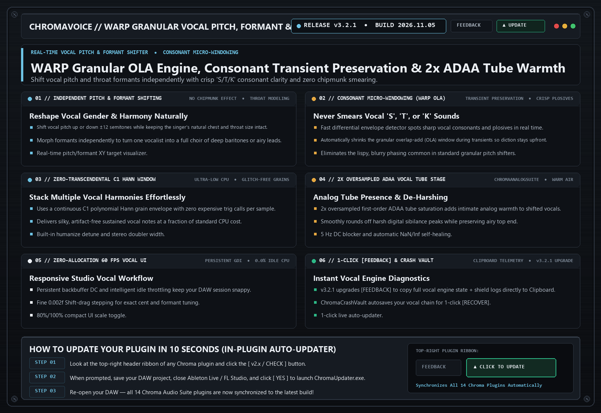

# ChromaVoice (`v3.2.1`)

> **WARP Granular Vocal Pitch, Formant & Harmony Processor**  
> Real-time vocal pitch and formant shifter featuring consonant micro-windowing and transient preservation so shifted vocals never sound smeared or robotic (unless you want them to!).

---

## 📚 Tech-to-Music Translator (How It Actually Works in Plain English)

### 🔹 Formants vs. Pitch (Why Chipmunk Vocals Happen)
When you sing a higher note, your vocal cords vibrate faster (Pitch), rapid-fire, but the size of your throat and mouth stays the same (Formants). Simple pitch shifters shrink the whole recording, making the singer's throat sound 3 inches long (the 'chipmunk' effect). Formant shifting lets you change the note while keeping the singer's natural chest and throat size intact—or morph a male vocal into a female or giant vocal at the same pitch!

### 🔹 Consonant Micro-Windowing (Transient Preservation)
Granular pitch shifters smear sharp vocal 'S', 'T', and 'K' sounds across multiple grains, making vocals sound lispy or blurry. ChromaVoice detects sharp consonants in real time and automatically shrinks the grain window so every 'T' and 'K' stays crisp and upfront.

---

## 🗂️ Version & Patch History

- **[`v3.2.1` (2026-11-05) — Upgraded 1-Click Clipboard [FEEDBACK] Diagnostic Reporting](./v3.2.1_2026-11-05.md)**
  - **2x Oversampled ADAA Vocal Tube Warmth Stage**: Smoothly rounds off harsh sibilance peaks while adding intimate analog vocal presence.
  - **Upgraded 1-Click Clipboard [FEEDBACK] Shield**: Automatically copies vocal engine diagnostics + `host_shield_log.txt` to your Windows Clipboard (`Ctrl+V` ready for Discord).

- **[`v3.2.0` (2026-10-22) — WARP Granular OLA Transient Preservation & Consonant Micro-Windowing](./v3.2.0_2026-10-22.md)**
  - **WARP Granular OLA Engine**: Fast differential envelope follower preserves vocal consonants and plosives.
  - **Zero-Transcendental C1 Polynomial Hann Window**: Ultra-low CPU overhead even when stacking multiple vocal harmony instances.

---

## 🛠️ Known Issues & Bug Reporting

- None currently open in v3.2.1.

**Found a bug or weird preset behavior?**  
Click the **`[ FEEDBACK ]`** button in the top-right header of the plugin! It automatically snapshots your patch, EQ curve, and screenshot, copies a diagnostic summary to your Clipboard (`Ctrl+V` ready for Discord), or opens a pre-filled [GitHub Bug Report](https://github.com/haidood/chroma-release/issues/new).
