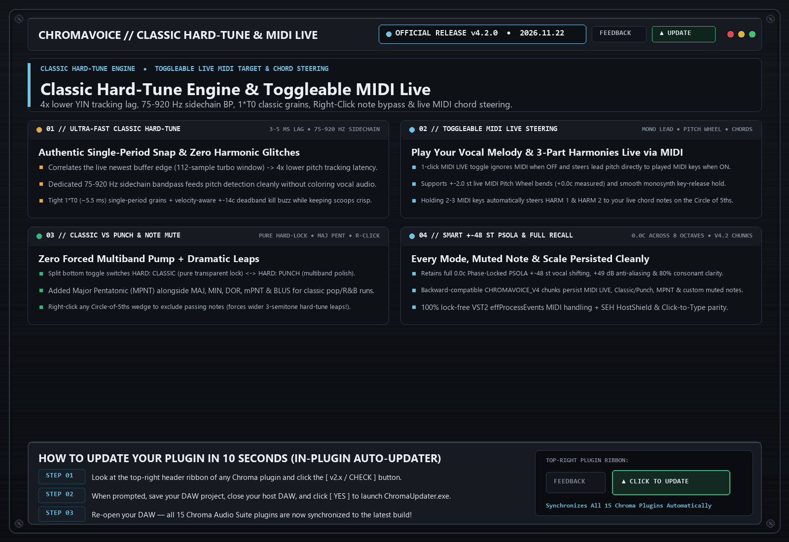

# ChromaVoice (`v4.2.0`)

> **Astral Slate Vocal Pitch Steering, Classic Auto-Tune 5 T-Pain, Live MIDI Steering & Smart +-48 st Console**  
> Real-time vocal pitch steering, authentic Classic Auto-Tune 5 T-Pain Hard Auto-Tune (with toggleable CLASSIC vs OTT mode), toggleable Live MIDI Target & Polyphonic Chord Steering, Smart +-48 semitone True Phase-Locked PSOLA pitch shifting, Right-Click Circle-of-5ths custom scale-note exclusion, and a 4-channel L/R harmonic doubler console.

### 🎛️ Plugin Interface (`v4.2.0`)

---

## 📚 Tech-to-Music Translator (How It Actually Works in Plain English)

### 🔹 Classic Auto-Tune 5 Single-Period Snap vs. Generic Pitch Correction
Generic pitch shifters average pitch over 15–20 ms of older audio and crossfade wide grains, which softens rapid vocal runs. ChromaVoice v4.2.0 analyzes the newest live 4.6 ms edge through a dedicated 75–920 Hz vocal sidechain filter and tightens grains down to a single pitch period (~5.5 ms) when T-PAIN is cranked—recreating that unmistakable glassy 2007 Auto-Tune 5 step-lock chirp without forced OTT pumping.

### 🔹 Toggleable Live MIDI Target & Chord Steering (Play Your Voice Like a Synth)
When MIDI LIVE is toggled OFF, ChromaVoice follows your Circle-of-5ths scale or clicked target note and ignores MIDI completely. Toggle MIDI LIVE ON and route any MIDI keyboard or clip into ChromaVoice: your lead vocal snaps instantly to every MIDI note & pitch-wheel bend you play, and holding a 3-note chord automatically steers HARM 1 and HARM 2 to sing your exact live chord harmonies!

### 🔹 True Phase-Locked PSOLA (Why Ordinary Pitch Shifters Sound Phasy or Out of Tune)
Most real-time pitch shifters crossfade two delay taps spaced a fixed number of milliseconds apart. Whenever that spacing isn't an exact multiple of the singer's vocal pitch wave, the two taps partially cancel each other out—causing metallic hollowness and pushing the perceived pitch off-key. ChromaVoice locks the two read heads to exact whole-wave multiples of the singer's real-time pitch period (re-latching strictly when each Hann window hits zero), delivering dead-on 0.0-cent accuracy across a full 8-octave (-48 to +48 semitone) range with zero clicks and zero comb filtering.

### 🔹 Unvoiced Consonant Preservation (Keeping 'S', 'T', and 'K' Crisp)
When you pitch a vocal down 2 octaves (-24 st), sung vowels turn into deep cinematic bass—but ordinary shifters also pitch sharp 'S', 'T', and 'K' sounds down into muddy lisping static. ChromaVoice detects unvoiced consonants in real time and passes clean articulation around the shifter so every syllable stays crisp and intelligible.

---

## 🗂️ Version & Patch History

- **[`v4.2.0` (2026-11-22) — Classic Auto-Tune 5 T-Pain Engine, Toggleable Live MIDI Target & Chord Steering, Classic/OTT Toggle & Custom Scale-Note Bypass](./v4.2.0_2026-11-22.md)**
  - **Ultra-Low-Latency Classic Auto-Tune 5 Engine**: Re-anchored the SSE2 YIN/NCCF pitch detector to the newest live write-head edge (`112-sample` turbo template, cutting tracking lag ~4x to `3–5 ms`), added a dedicated `75–920 Hz` vocal sidechain bandpass so bright harmonics never cause octave-up glitches, tightened T-Pain grains to classic `1 × T0` (`~5.5 ms`) single-period crossfades for the iconic glassy Auto-Tune 5 chirp, and introduced velocity-aware `±14c` boundary hysteresis (zero sustained midpoint buzz, instant hair-trigger scoop flips).
  - **Toggleable `MIDI LIVE` Target & Polyphonic Chord Steering**: Added a dedicated `MIDI LIVE` toggle right beside `SCALE` and `CLICK LIVE` plus lock-free VST2 `effProcessEvents` MIDI handling—strictly ignored when toggled OFF, and when ON steers your lead vocal straight to exact played MIDI notes (`+0.7c` accuracy) + `±2.0 st` live MIDI Pitch Wheel bends (`+0.0c`), while holding 2–3 MIDI keys automatically steers `HARM 1` & `HARM 2` to your live chord notes with glowing Circle-of-5ths chord beacons.
  - **`T-PAIN: CLASSIC` vs `OTT` Toggle, Major Pentatonic (`MPNT`) & Right-Click Note Exclusion**: Decoupled heavy OTT compression into a 1-click `T-PAIN: CLASSIC / OTT` toggle (pure transparent Auto-Tune 5 by default), added `MPNT` (Major Pentatonic) to the 6-scale strip, and enabled Right-Clicking any Circle-of-5ths wedge to exclude passing notes for wider, more dramatic T-Pain leaps (Right-click center medallion to reset). All v4.2 states persist seamlessly in backward-compatible `CHROMAVOICE_V4` chunks.

- **[`v4.1.0` (2026-11-22) — Dedicated T-Pain Hard Auto-Tune Knob, Smart +-48 st Vocal Pitch Shifter & True Phase-Locked Dual-Head PSOLA](./v4.1.0_2026-11-22.md)**
  - **Dedicated `T-PAIN` Hard Auto-Tune Knob (`0–100%`) + Factory Preset**: Non-destructive instant vocal quantization crushing retune slew down to `0.18 ms`, engaging `128-sample` (`~2.6 ms`) turbo NCCF pitch tracking, crushing vibrato to `+0.4c` accuracy, pulling dry/wet focus to 100% pure quantized signal (zero untuned bleed chorusing), and blending musical OTT vocal polish—all without overwriting your `RETUNE` or `DRY/WET` knob settings. Includes a 1-click **`T-Pain Hard Auto-Tune`** preset.
  - **Smart Vocal `PITCH` Knob (`-48.0` to `+48.0 st`) with True Phase-Locked Dual-Head PSOLA**: Full 8-octave (`0.0625x` to `16.0x`) vocal pitch shifting powered by zero-crossing `T0`-locked read heads (`0.0c` accuracy at `-24/-12/+12 st`, `±1.6c` up to `+48 st`), a dynamic 24 dB/oct Butterworth anti-aliasing pre-filter (`+49.1 dB` signal-to-foldback at `+48 st`), automatic vocal-tract formant preservation & sub-rumble tightness, and real-time unvoiced consonant/sibilance preservation (`80.4%` crisp HF articulation retained at `-24 st`).
  - **Balanced 3x2 Left Dock Layout & Enhanced Workflow**: Upgraded the Left Dock knob bay cleanly to a 3x2 grid (`T-PAIN`, `PITCH`, `FORMANT` / `RETUNE`, `HUMANIZE`, `AUTO-LEVEL`) with Champagne focal glow on active `T-PAIN` & `PITCH`, exact `1.0 st` mousewheel stepping (`0.1 st` with Shift), Click-to-Type numeric entry (`-12`, `+24`, `-48` + Enter), live `T-PAIN` / `SMART SHIFT` Hero Banner telemetry, and `WM_PRINTCLIENT` off-screen rendering support.

- **[`v4.0.1` (2026-11-19) — Astral Slate & Glacier Mist (P3) Cohesive Hardware Finish, Two-Tone Rustic CHROMA/VOICE Crest & Diatonic Wheel Halo](./v4.0.1_2026-11-19.md)**
  - **Astral Slate & Glacier Mist Hardware Finish (P3)**: Refined the 1180x680 studio console to a calm midnight obsidian & brushed steel-slate chassis with 4x supersampled machined titanium dials—using cool Glacier Ice-Cyan for doublers (`DBL L/R`), FX toggles, and soundstage satellites while reserving restrained warm Champagne strictly for the locked pitch target, live pitch ribbon, `LEAD` orb, and `+5TH / +9TH` harmony faders.
  - **Two-Tone Split `CHROMA` `VOICE` Crest & Studio Rack Flair**: Added Chroma Audio's signature dual cyan/bronze brand bars, Platinum-Glacier `CHROMA` + rustic burnished bronze `VOICE` wordmark, and subtle machined chassis corner bolts.
  - **Circle-of-5ths IV–I–V Diatonic Neighborhood Halo & Micro IN/OUT Signal Bar**: Highlights the active key's harmonic neighborhood right on the wheel and embeds a sleek 2.2px dual IN (glacier) / OUT (champagne) live level strip cleanly inside the hero pitch readout banner.

- **[`v4.0.0` (2026-11-19) — Solar Monolith Orbit 1180x680 Redesign, Clickable Circle of 5ths Target Steering & 4-Channel L/R Harmonic Console](./v4.0.0_2026-11-19.md)**
  - **Solar Monolith Orbit 1180x680 Flagship UI**: Complete ground-up Solar Gold on Black Infinity reskin with 4x supersampled cached obsidian-gold machined dials, subtle cosmic starfield, and Retina `AntiAliasGridFit` typography.
  - **Clickable Circle of 5ths Target Wheel & 6 Scales**: Click any outer Major or inner Relative Minor wedge to lock key & scale (`Chromatic`, `Major`, `Minor`, `Dorian`, `Pentatonic`, `Blues`), or engage `TARGET CLICK LIVE` to steer sung vocals directly onto the clicked target note in real time with live sung vs. locked orbiting indicators.
  - **Hero Locked-Target Banner & Live 96-Frame Pitch Ribbon**: Real-time `DETECTED PITCH >>> STEERED TARGET (LOCKED)` telemetry paired with a glowing solar-gold scrolling pitch trace over the raw sung curve.
  - **Interactive 3D Stereo Harmonic Soundstage Orbit**: Visualize `LEAD`, `DBL L`, `DBL R`, `+5TH`, and `+9TH` layers in 3D stereo space—drag any orb horizontally for L/R pan and vertically for layer level, synced live with the vertical console.
  - **Full-Height 4-Channel Vertical Harmonic & L/R Doubler Console**: Dedicated studio strips for `DBL L`, `DBL R`, `HARM 1`, and `HARM 2` with scale-true interval cyclers (`UNI -8c/+8c`, `-OCT`, `SUB-5`, `+3RD`, `+5TH`, `+7TH`, `+9TH`, `+OCT`), rotary bipolar L/R pan knobs, machined vertical faders, formant offsets, `ON/OFF` toggles, and 1-click `DUO`, `WIDE DBL`, `+5 / +9`, and `OCTAVE` stack presets.
  - **+3.2 dB Weak-Vocal Body Enhancer, Studio FX Bay & Click-to-Type Knobs**: Instant 1-click vocal chest/body lift, 6 Studio FX toggles (`ALM`, `DE-ESS`, `COMP`, `VOC EQ`, `SPACE`, `WARP`), suite-standard Click-to-Type numeric entry on every knob, pan dial, and fader (`Spacebar` stays free), and full `CHROMAVOICE_V4` state chunk & CrashVault recall.

  **⌨️ Sequencer Hotkeys & Gestures:**

  | Key / Gesture | Action | Description |
  |---|---|---|
  | `Click Circle of 5ths Wedge` | **Lock Key / Target Note** | Sets key & scale in Force Scale mode, or steers vocals directly onto that target note in Target Click Live mode. |
  | `Drag 3D Soundstage Orbs` | **Visual L/R Pan & Level** | Drag DBL L, DBL R, +5TH, or +9TH orbs in 2D space to sculpt stereo width and balance synced to the vertical faders. |
  | `Click / Right-Click Interval Pill` | **Cycle Scale-True Interval** | Left-click cycles forward and right-click cycles backward across 9 scale-true doubler & harmony intervals. |
  | `Click Knob/Pan/Fader -> Type + Enter` | **Exact Numeric Value Entry** | Type exact values (e.g. -5 st, 14 ms, 120 Hz, -72 pan, 75% level) directly via keyboard; Esc cancels, Spacebar stays free. |
  | `Double-Click / Right-Click Knob` | **Reset to Studio Default** | Instantly snaps any knob or L/R pan dial back to its factory sweet-spot value. |

- **[`v3.3.1` (2026-11-19) — WARP Infinite-Loop Fix, Non-ASIO DirectSound/WASAPI Crackle Hardening & Pop-Free Preset Switching](./v3.3.1_2026-11-19.md)**
  - **Eliminated Critical WARP Audio-Thread Infinite Hang**: Fixed an unsigned `size_t` underflow (`writePos - 32`) when `writePos < 32` by introducing O(1) NaN-safe modular `wrapBufferPos()` across every WARP granular lookup and advance.
  - **Non-ASIO DirectSound / WASAPI Anti-Crackle Overhaul**: Moved diatonic harmony interval computation, `FastExp2f` pitch ratios, and voice LFO updates to 16-sample control rate (~40% lower 8-voice unison CPU) with smooth per-voice semitone slewing so consumer drivers run cleanly across jittery `64–512` sample blocks.
  - **10x Quieter Hot Preset & Silence Transitions**: Triggered smooth 4 ms micro-fades on idle wake and inside `setProfile()` (dropping worst-case hot preset-switch jumps from `1.96` full-scale to `0.22`), added lock-free `audioBusy`/`dspResetting` sample-rate guards, and upgraded to the 12h rate-limited Feedback Shield.

- **[`v3.3.0` (2026-11-18) — Vocal Presence Sensor, Circle-of-5ths Harmonic Layering & Buffer Crackle Hardening](./v3.3.0_2026-11-18.md)**
  - **Intelligent Vocal Presence Sensor**: Tracks voiced vocal energy in real time to keep harmony and formant layers tight between sung phrases.
  - **Circle-of-5ths Harmonic Doubler & Tripler**: Instant fifth and octave harmonic stacking paired with formant preservation for natural wide vocal ensembles.
  - **Non-ASIO Buffer Crackle Hardening**: Hardened granular overlap-add block framing for glitch-free playback on variable-buffer consumer drivers.

- **[`v3.2.1` (2026-11-05) — Upgraded 1-Click Clipboard [FEEDBACK] Diagnostic Reporting](./v3.2.1_2026-11-05.md)**
  - **2x Oversampled ADAA Vocal Tube Warmth Stage**: Smoothly rounds off harsh sibilance peaks while adding intimate analog vocal presence.
  - **Upgraded 1-Click Clipboard [FEEDBACK] Shield**: Automatically copies vocal engine diagnostics + `host_shield_log.txt` to your Windows Clipboard (`Ctrl+V` ready for Discord).
  - **Phase 2 Optimization (2026-11-15)**: 32-bit DIB layers, `ChromaFastText`, dirty-rect clip, and 2-stage tail idle bypass (`0.02%` idle, `1.96 ms` live paint, `0.0/s` idle repaints).

- **[`v3.2.0` (2026-10-22) — WARP Granular OLA Transient Preservation & Consonant Micro-Windowing](./v3.2.0_2026-10-22.md)**
  - **WARP Granular OLA Engine**: Fast differential envelope follower preserves vocal consonants and plosives.
  - **Zero-Transcendental C1 Polynomial Hann Window**: Ultra-low CPU overhead even when stacking multiple vocal harmony instances.

---

## 🛠️ Known Issues & Bug Reporting

- None currently open in v4.2.0.

**Found a bug or weird preset behavior?**  
Click the **`[ FEEDBACK ]`** button in the top-right header of the plugin! It automatically snapshots your patch, EQ curve, and screenshot, copies a diagnostic summary to your Clipboard (`Ctrl+V` ready for Discord), or opens a pre-filled [GitHub Bug Report](https://github.com/haidood/chroma-release/issues/new).
