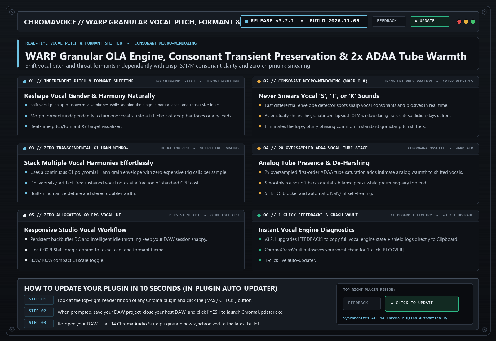

# ChromaVoice `v3.2.1` — Release Notes (2026-11-05)

**[⬅ Back to ChromaVoice Overview & Glossary](./README.md)**

## Upgraded 1-Click Clipboard [FEEDBACK] Diagnostic Reporting

### What Changed & Why It Matters Musically

- **2x Oversampled ADAA Vocal Tube Warmth Stage**: Smoothly rounds off harsh sibilance peaks while adding intimate analog vocal presence.
- **Upgraded 1-Click Clipboard [FEEDBACK] Shield**: Automatically copies vocal engine diagnostics + `host_shield_log.txt` to your Windows Clipboard (`Ctrl+V` ready for Discord).

---
### ⚡ How to Update in 10 Seconds
1. Click the **`[ v2.x / CHECK ]`** button in the top-right header bar of the plugin.
2. Close your DAW and click **`[ YES ]`** in the prompt to run `ChromaUpdater.exe`.
3. Re-open your DAW — you are now on the latest build!
