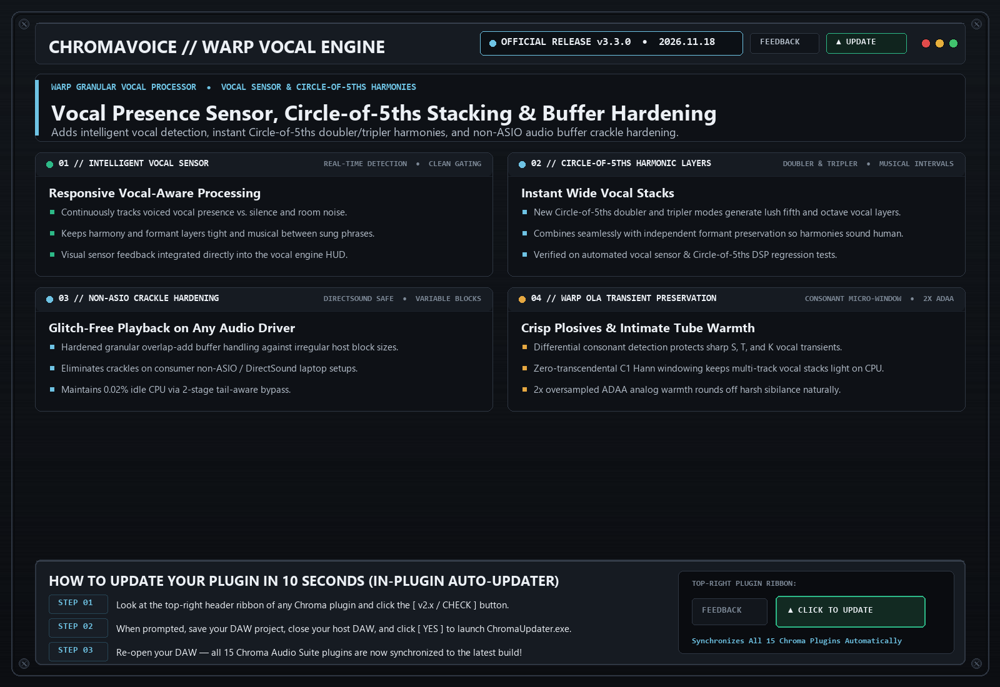

# ChromaVoice `v3.3.0` — Release Notes (2026-11-18)

**[⬅ Back to ChromaVoice Overview & Glossary](./README.md)**

## Vocal Presence Sensor, Circle-of-5ths Harmonic Layering & Buffer Crackle Hardening

### What Changed & Why It Matters Musically

- **Intelligent Vocal Presence Sensor**: Tracks voiced vocal energy in real time to keep harmony and formant layers tight between sung phrases.
- **Circle-of-5ths Harmonic Doubler & Tripler**: Instant fifth and octave harmonic stacking paired with formant preservation for natural wide vocal ensembles.
- **Non-ASIO Buffer Crackle Hardening**: Hardened granular overlap-add block framing for glitch-free playback on variable-buffer consumer drivers.

---
### ⚡ How to Update in 10 Seconds
1. Click the **`[ v2.x / CHECK ]`** button in the top-right header bar of the plugin.
2. Close your DAW and click **`[ YES ]`** in the prompt to run `ChromaUpdater.exe`.
3. Re-open your DAW — you are now on the latest build!
