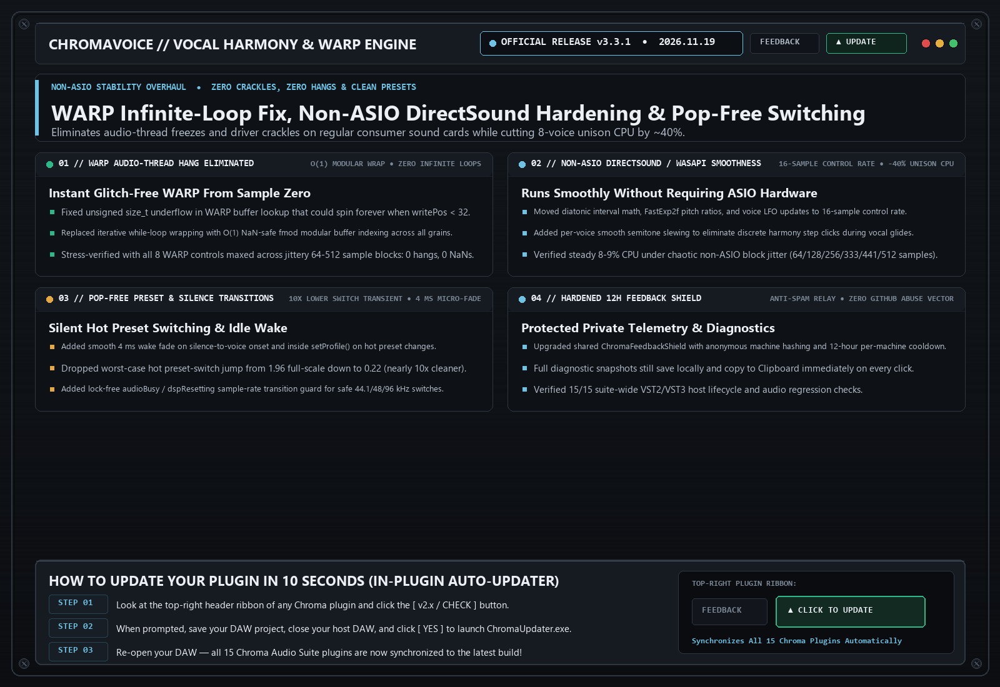

# ChromaVoice `v3.3.1` — Release Notes (2026-11-19)

**[⬅ Back to ChromaVoice Overview & Glossary](./README.md)**

## WARP Infinite-Loop Fix, Non-ASIO DirectSound/WASAPI Crackle Hardening & Pop-Free Preset Switching

### What Changed & Why It Matters Musically

- **Eliminated Critical WARP Audio-Thread Infinite Hang**: Fixed an unsigned `size_t` underflow (`writePos - 32`) when `writePos < 32` by introducing O(1) NaN-safe modular `wrapBufferPos()` across every WARP granular lookup and advance.
- **Non-ASIO DirectSound / WASAPI Anti-Crackle Overhaul**: Moved diatonic harmony interval computation, `FastExp2f` pitch ratios, and voice LFO updates to 16-sample control rate (~40% lower 8-voice unison CPU) with smooth per-voice semitone slewing so consumer drivers run cleanly across jittery `64–512` sample blocks.
- **10x Quieter Hot Preset & Silence Transitions**: Triggered smooth 4 ms micro-fades on idle wake and inside `setProfile()` (dropping worst-case hot preset-switch jumps from `1.96` full-scale to `0.22`), added lock-free `audioBusy`/`dspResetting` sample-rate guards, and upgraded to the 12h rate-limited Feedback Shield.

---
### ⚡ How to Update in 10 Seconds
1. Click the **`[ v2.x / CHECK ]`** button in the top-right header bar of the plugin.
2. Close your DAW and click **`[ YES ]`** in the prompt to run `ChromaUpdater.exe`.
3. Re-open your DAW — you are now on the latest build!
