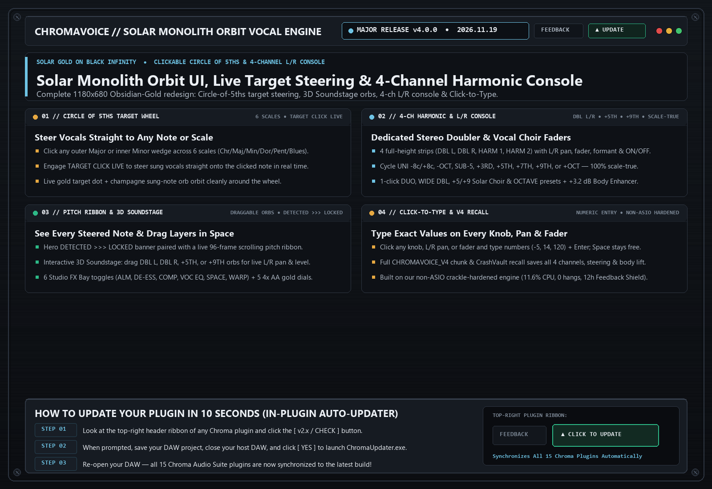

# ChromaVoice `v4.0.0` — Release Notes (2026-11-19)

**[⬅ Back to ChromaVoice Overview & Glossary](./README.md)**

## Solar Monolith Orbit 1180x680 Redesign, Clickable Circle of 5ths Target Steering & 4-Channel L/R Harmonic Console

### What Changed & Why It Matters Musically

- **Solar Monolith Orbit 1180x680 Flagship UI**: Complete ground-up Solar Gold on Black Infinity reskin with 4x supersampled cached obsidian-gold machined dials, subtle cosmic starfield, and Retina `AntiAliasGridFit` typography.
- **Clickable Circle of 5ths Target Wheel & 6 Scales**: Click any outer Major or inner Relative Minor wedge to lock key & scale (`Chromatic`, `Major`, `Minor`, `Dorian`, `Pentatonic`, `Blues`), or engage `TARGET CLICK LIVE` to steer sung vocals directly onto the clicked target note in real time with live sung vs. locked orbiting indicators.
- **Hero Locked-Target Banner & Live 96-Frame Pitch Ribbon**: Real-time `DETECTED PITCH >>> STEERED TARGET (LOCKED)` telemetry paired with a glowing solar-gold scrolling pitch trace over the raw sung curve.
- **Interactive 3D Stereo Harmonic Soundstage Orbit**: Visualize `LEAD`, `DBL L`, `DBL R`, `+5TH`, and `+9TH` layers in 3D stereo space—drag any orb horizontally for L/R pan and vertically for layer level, synced live with the vertical console.
- **Full-Height 4-Channel Vertical Harmonic & L/R Doubler Console**: Dedicated studio strips for `DBL L`, `DBL R`, `HARM 1`, and `HARM 2` with scale-true interval cyclers (`UNI -8c/+8c`, `-OCT`, `SUB-5`, `+3RD`, `+5TH`, `+7TH`, `+9TH`, `+OCT`), rotary bipolar L/R pan knobs, machined vertical faders, formant offsets, `ON/OFF` toggles, and 1-click `DUO`, `WIDE DBL`, `+5 / +9`, and `OCTAVE` stack presets.
- **+3.2 dB Weak-Vocal Body Enhancer, Studio FX Bay & Click-to-Type Knobs**: Instant 1-click vocal chest/body lift, 6 Studio FX toggles (`ALM`, `DE-ESS`, `COMP`, `VOC EQ`, `SPACE`, `WARP`), suite-standard Click-to-Type numeric entry on every knob, pan dial, and fader (`Spacebar` stays free), and full `CHROMAVOICE_V4` state chunk & CrashVault recall.

### ⌨️ Hotkey & Gesture Quick Reference

| Key / Gesture | Action | Description |
|---|---|---|
| `Click Circle of 5ths Wedge` | **Lock Key / Target Note** | Sets key & scale in Force Scale mode, or steers vocals directly onto that target note in Target Click Live mode. |
| `Drag 3D Soundstage Orbs` | **Visual L/R Pan & Level** | Drag DBL L, DBL R, +5TH, or +9TH orbs in 2D space to sculpt stereo width and balance synced to the vertical faders. |
| `Click / Right-Click Interval Pill` | **Cycle Scale-True Interval** | Left-click cycles forward and right-click cycles backward across 9 scale-true doubler & harmony intervals. |
| `Click Knob/Pan/Fader -> Type + Enter` | **Exact Numeric Value Entry** | Type exact values (e.g. -5 st, 14 ms, 120 Hz, -72 pan, 75% level) directly via keyboard; Esc cancels, Spacebar stays free. |
| `Double-Click / Right-Click Knob` | **Reset to Studio Default** | Instantly snaps any knob or L/R pan dial back to its factory sweet-spot value. |

---
### ⚡ How to Update in 10 Seconds
1. Click the **`[ v2.x / CHECK ]`** button in the top-right header bar of the plugin.
2. Close your DAW and click **`[ YES ]`** in the prompt to run `ChromaUpdater.exe`.
3. Re-open your DAW — you are now on the latest build!
