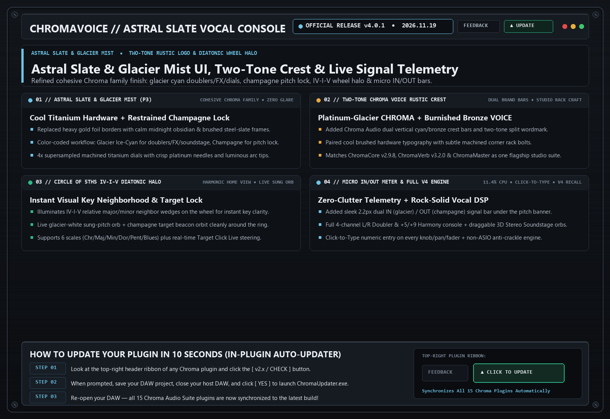

# ChromaVoice `v4.0.1` — Release Notes (2026-11-19)

**[⬅ Back to ChromaVoice Overview & Glossary](./README.md)**

## Astral Slate & Glacier Mist (P3) Cohesive Hardware Finish, Two-Tone Rustic CHROMA/VOICE Crest & Diatonic Wheel Halo

### What Changed & Why It Matters Musically

- **Astral Slate & Glacier Mist Hardware Finish (P3)**: Refined the 1180x680 studio console to a calm midnight obsidian & brushed steel-slate chassis with 4x supersampled machined titanium dials—using cool Glacier Ice-Cyan for doublers (`DBL L/R`), FX toggles, and soundstage satellites while reserving restrained warm Champagne strictly for the locked pitch target, live pitch ribbon, `LEAD` orb, and `+5TH / +9TH` harmony faders.
- **Two-Tone Split `CHROMA` `VOICE` Crest & Studio Rack Flair**: Added Chroma Audio's signature dual cyan/bronze brand bars, Platinum-Glacier `CHROMA` + rustic burnished bronze `VOICE` wordmark, and subtle machined chassis corner bolts.
- **Circle-of-5ths IV–I–V Diatonic Neighborhood Halo & Micro IN/OUT Signal Bar**: Highlights the active key's harmonic neighborhood right on the wheel and embeds a sleek 2.2px dual IN (glacier) / OUT (champagne) live level strip cleanly inside the hero pitch readout banner.

---
### ⚡ How to Update in 10 Seconds
1. Click the **`[ v2.x / CHECK ]`** button in the top-right header bar of the plugin.
2. Close your DAW and click **`[ YES ]`** in the prompt to run `ChromaUpdater.exe`.
3. Re-open your DAW — you are now on the latest build!
