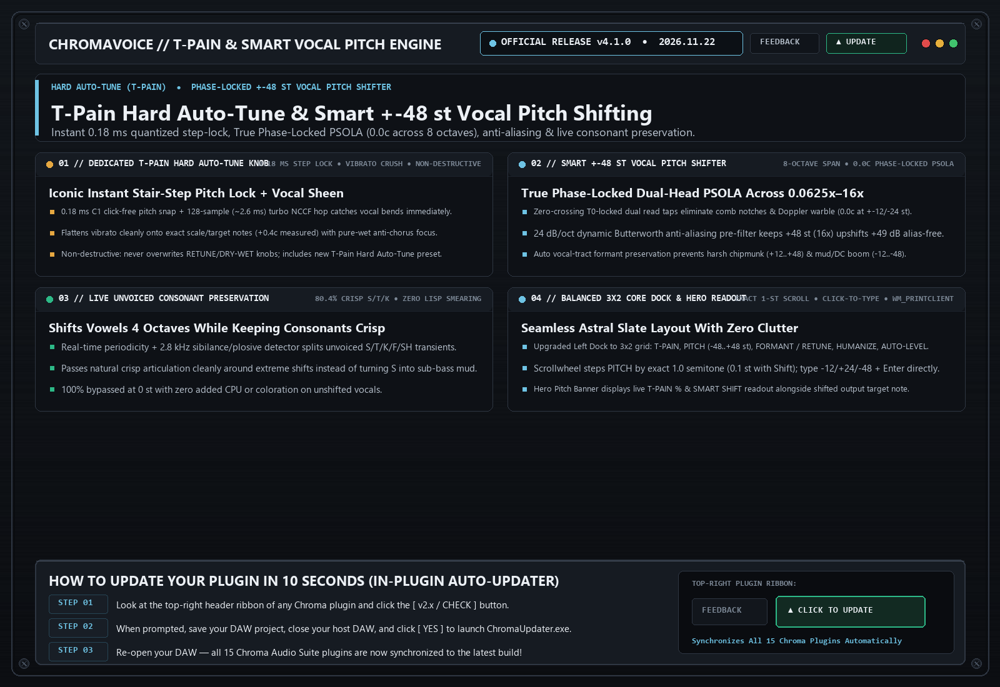

# ChromaVoice `v4.1.0` — Release Notes (2026-11-22)

**[⬅ Back to ChromaVoice Overview & Glossary](./README.md)**

## Dedicated T-Pain Hard Auto-Tune Knob, Smart +-48 st Vocal Pitch Shifter & True Phase-Locked Dual-Head PSOLA

### What Changed & Why It Matters Musically

- **Dedicated `T-PAIN` Hard Auto-Tune Knob (`0–100%`) + Factory Preset**: Non-destructive instant vocal quantization crushing retune slew down to `0.18 ms`, engaging `128-sample` (`~2.6 ms`) turbo NCCF pitch tracking, crushing vibrato to `+0.4c` accuracy, pulling dry/wet focus to 100% pure quantized signal (zero untuned bleed chorusing), and blending musical OTT vocal polish—all without overwriting your `RETUNE` or `DRY/WET` knob settings. Includes a 1-click **`T-Pain Hard Auto-Tune`** preset.
- **Smart Vocal `PITCH` Knob (`-48.0` to `+48.0 st`) with True Phase-Locked Dual-Head PSOLA**: Full 8-octave (`0.0625x` to `16.0x`) vocal pitch shifting powered by zero-crossing `T0`-locked read heads (`0.0c` accuracy at `-24/-12/+12 st`, `±1.6c` up to `+48 st`), a dynamic 24 dB/oct Butterworth anti-aliasing pre-filter (`+49.1 dB` signal-to-foldback at `+48 st`), automatic vocal-tract formant preservation & sub-rumble tightness, and real-time unvoiced consonant/sibilance preservation (`80.4%` crisp HF articulation retained at `-24 st`).
- **Balanced 3x2 Left Dock Layout & Enhanced Workflow**: Upgraded the Left Dock knob bay cleanly to a 3x2 grid (`T-PAIN`, `PITCH`, `FORMANT` / `RETUNE`, `HUMANIZE`, `AUTO-LEVEL`) with Champagne focal glow on active `T-PAIN` & `PITCH`, exact `1.0 st` mousewheel stepping (`0.1 st` with Shift), Click-to-Type numeric entry (`-12`, `+24`, `-48` + Enter), live `T-PAIN` / `SMART SHIFT` Hero Banner telemetry, and `WM_PRINTCLIENT` off-screen rendering support.

---
### ⚡ How to Update in 10 Seconds
1. Click the **`[ v2.x / CHECK ]`** button in the top-right header bar of the plugin.
2. Close your DAW and click **`[ YES ]`** in the prompt to run `ChromaUpdater.exe`.
3. Re-open your DAW — you are now on the latest build!
