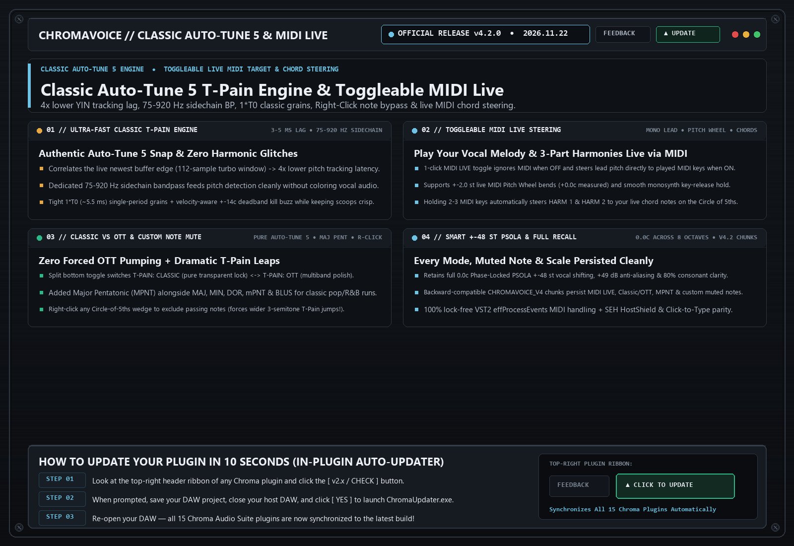

# ChromaVoice `v4.2.0` — Release Notes (2026-11-22)

**[⬅ Back to ChromaVoice Overview & Glossary](./README.md)**

## Classic Auto-Tune 5 T-Pain Engine, Toggleable Live MIDI Target & Chord Steering, Classic/OTT Toggle & Custom Scale-Note Bypass

### What Changed & Why It Matters Musically

- **Ultra-Low-Latency Classic Auto-Tune 5 Engine**: Re-anchored the SSE2 YIN/NCCF pitch detector to the newest live write-head edge (`112-sample` turbo template, cutting tracking lag ~4x to `3–5 ms`), added a dedicated `75–920 Hz` vocal sidechain bandpass so bright harmonics never cause octave-up glitches, tightened T-Pain grains to classic `1 × T0` (`~5.5 ms`) single-period crossfades for the iconic glassy Auto-Tune 5 chirp, and introduced velocity-aware `±14c` boundary hysteresis (zero sustained midpoint buzz, instant hair-trigger scoop flips).
- **Toggleable `MIDI LIVE` Target & Polyphonic Chord Steering**: Added a dedicated `MIDI LIVE` toggle right beside `SCALE` and `CLICK LIVE` plus lock-free VST2 `effProcessEvents` MIDI handling—strictly ignored when toggled OFF, and when ON steers your lead vocal straight to exact played MIDI notes (`+0.7c` accuracy) + `±2.0 st` live MIDI Pitch Wheel bends (`+0.0c`), while holding 2–3 MIDI keys automatically steers `HARM 1` & `HARM 2` to your live chord notes with glowing Circle-of-5ths chord beacons.
- **`T-PAIN: CLASSIC` vs `OTT` Toggle, Major Pentatonic (`MPNT`) & Right-Click Note Exclusion**: Decoupled heavy OTT compression into a 1-click `T-PAIN: CLASSIC / OTT` toggle (pure transparent Auto-Tune 5 by default), added `MPNT` (Major Pentatonic) to the 6-scale strip, and enabled Right-Clicking any Circle-of-5ths wedge to exclude passing notes for wider, more dramatic T-Pain leaps (Right-click center medallion to reset). All v4.2 states persist seamlessly in backward-compatible `CHROMAVOICE_V4` chunks.

---
### ⚡ How to Update in 10 Seconds
1. Click the **`[ v2.x / CHECK ]`** button in the top-right header bar of the plugin.
2. Close your DAW and click **`[ YES ]`** in the prompt to run `ChromaUpdater.exe`.
3. Re-open your DAW — you are now on the latest build!
