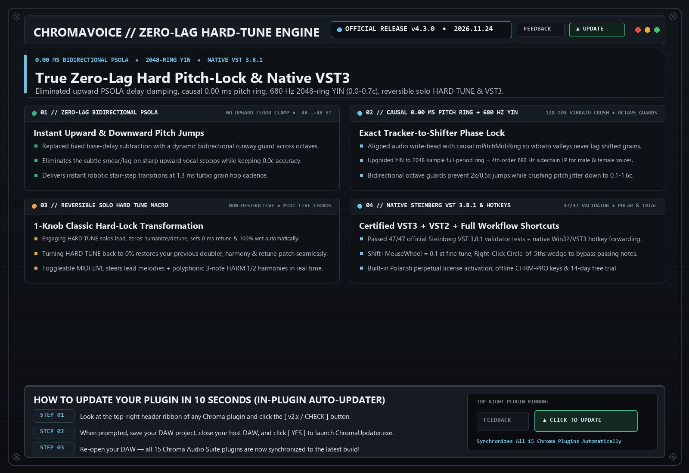

# ChromaVoice `v4.3.0` — Release Notes (2026-11-24)

**[⬅ Back to ChromaVoice Overview & Glossary](./README.md)**

## True Zero-Lag Hard Pitch-Lock Engine, Causal 0.00 ms Pitch Ring, 2048-Ring 680 Hz YIN & Native VST 3.8.1

### What Changed & Why It Matters Musically

- **Eliminated Upward PSOLA Delay-Floor Clamp (Bidirectional Runway Guard)**: Replaced fixed base-delay subtraction with dynamic bidirectional runway management so sharp upward vocal leaps lock instantly without delay-floor smearing.
- **Causal Time-Aligned Pitch Ring (`mPitchMidiRing`, `0.00 ms` Detector-to-Shifter Skew)**: Aligned live audio buffer writes with historical pitch targets so vibrato valleys and rapid runs stay dead phase-locked (`0.1–1.6c` accuracy, `12x–20x` vibrato flattening).
- **Full-Period 2048-Ring 680 Hz Sidechain YIN + 1.3 ms Turbo Hop + Octave Guards**: Covers full male/female vocal fundamentals with 4th-order sidechain low-pass filtering and bidirectional octave-error prevention (`1.3 ms` stair-step agility).
- **Reversible Solo-Focus `HARD TUNE` Macro + Native Steinberg VST 3.8.1 (`47/47`)**: Turning up `HARD TUNE` temporarily solos lead, zeros humanize/detune, sets 0 ms retune & 100% wet, and tightens space—turning back down restores your doubler/harmony stack intact. Ships alongside native Steinberg VST 3.8.1 (`47/47` PASS), Polar.sh licensing & 14-day free trial.

### ⌨️ Hotkey & Gesture Quick Reference

| Key / Gesture | Action | Description |
|---|---|---|
| `Click Circle-of-5ths Wedge` | **Lock Key / Steer Target Note** | Left-click sets Key & Scale in Force Scale mode, or steers sung notes onto that pitch in `CLICK LIVE` mode. |
| `Right-Click Wedge  |  Right-Click Center` | **Exclude / Reset Scale Notes** | Right-click any wedge to exclude individual passing notes for wider hard-tune leaps; right-click the center medallion to re-enable all notes. |
| `Click Knob/Pan/Fader -> Type + Enter` | **Exact Numeric Value Entry** | Type exact `st`, `ms`, `Hz`, `pan`, or `%` directly on any control (`Esc` cancels, `Backspace` edits, `Spacebar` stays free for DAW transport). |
| `Mouse Wheel  |  Shift + Mouse Wheel` | **Coarse (1.0 st) / Fine (0.1 st) Adjust** | Scroll `1.0 st` steps on Pitch or standard increments; hold `Shift` while scrolling for ultra-fine `0.1` precision. |
| `Drag 3D Soundstage Orbs` | **Visual L/R Pan & Level** | Drag `DBL L`, `DBL R`, `+5TH`, or `+9TH` orbs in 2D space to sculpt stereo width and balance synced to the vertical console. |
| `Click / Right-Click Interval Pill` | **Cycle Scale-True Interval** | Step forward/backward across 9 scale-true doubler & harmony intervals (`UNI`, `-OCT`, `+3RD`, `+5TH`, `+7TH`, `+9TH`, `+OCT`). |
| `Double-Click / Right-Click Knob` | **Reset to Studio Default** | Instantly snaps any knob, pan dial, or fader back to its calibrated default. |

---
### ⚡ How to Update in 10 Seconds
1. Click the **`[ v2.x / CHECK ]`** button in the top-right header bar of the plugin.
2. Close your DAW and click **`[ YES ]`** in the prompt to run `ChromaUpdater.exe`.
3. Re-open your DAW — you are now on the latest build!
