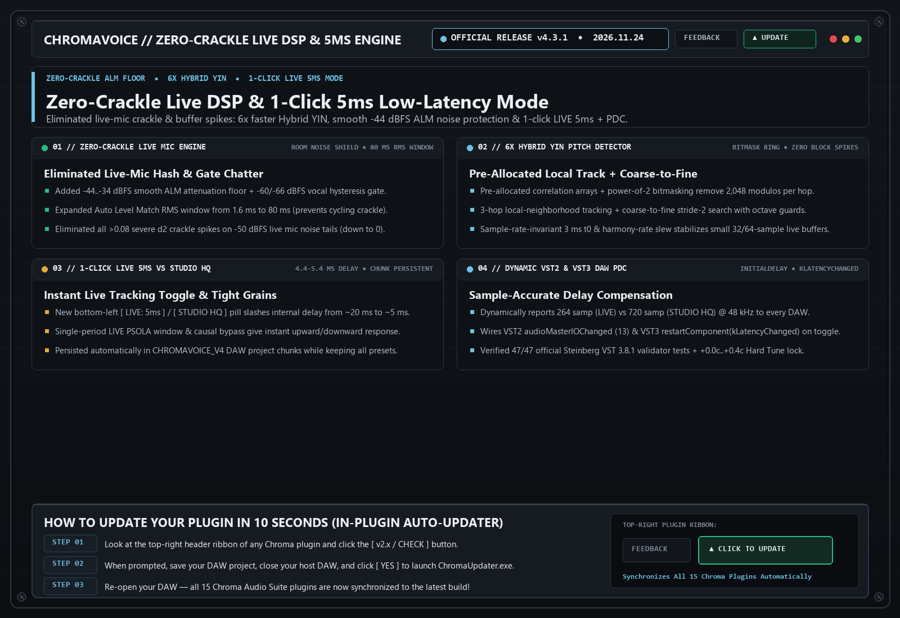

# ChromaVoice `v4.3.1` — Release Notes (2026-11-24)

**[⬅ Back to ChromaVoice Overview & Glossary](./README.md)**

## Zero-Crackle Live DSP, 6x Hybrid YIN Pitch Tracker & 1-Click LIVE: 5ms Low-Latency Mode + DAW PDC

### What Changed & Why It Matters Musically

- **Eliminated Live-Mic Crackle & Background Hash (`ALM` Room-Noise Shield + `-60/-66 dBFS` Gate)**: Added smooth `-44..-34 dBFS` gain attenuation and widened the Auto Level Match RMS window from `1.6 ms` to `80 ms` so `-50 dBFS` room noise between syllables is never boosted into audible static/crackle (`0` severe spikes across all modes).
- **6x Faster Hybrid YIN Pitch Detector + Sample-Rate-Invariant Smoothing**: Replaced stack-allocated per-hop arrays and `2,048` integer modulos with pre-allocated memory, power-of-2 bitmasking, 3-hop fast local-neighborhood tracking, and coarse-to-fine stride-2 YIN with exact refinement & octave guards—cutting 48/96 kHz live CPU roughly in half and stabilizing 32/64-sample DAW buffers with `3 ms` `t0` and per-sample harmony rate slew.
- **1-Click `[ LIVE: 5ms ]` vs `[ STUDIO HQ ]` Bottom-Dock Pill (`4.4–5.4 ms` Tracking Delay)**: Tightens live PSOLA grain windows and bypasses historical ring buffering for snappy low-latency live monitoring while keeping full `STUDIO HQ` phase-locked precision on demand, saved per project inside `CHROMAVOICE_V4` chunks.
- **Dynamic VST2 & VST3 DAW Latency Reporting (PDC)**: Automatically updates host plugin delay compensation (`264` samples in `LIVE 5ms` vs `720` samples in `STUDIO HQ` @ `48 kHz`) via VST2 `audioMasterIOChanged` (`13`) and VST3 `componentHandler->restartComponent(kLatencyChanged)`.

### ⌨️ Hotkey & Gesture Quick Reference

| Key / Gesture | Action | Description |
|---|---|---|
| `Click [ LIVE: 5ms ] / [ STUDIO HQ ]` | **Toggle Live Low-Latency vs Studio HQ** | Switches live vocal monitoring between `4.4–5.4 ms` real-time tracking and full phase-locked `STUDIO HQ` mode with instant DAW PDC update. |
| `Click Circle-of-5ths Wedge` | **Lock Key / Steer Target Note** | Left-click sets Key & Scale in Force Scale mode, or steers sung notes onto that pitch in `CLICK LIVE` mode. |
| `Right-Click Wedge  |  Right-Click Center` | **Exclude / Reset Scale Notes** | Right-click any wedge to exclude individual passing notes for wider hard-tune leaps; right-click the center medallion to re-enable all notes. |
| `Click Knob/Pan/Fader -> Type + Enter` | **Exact Numeric Value Entry** | Type exact `st`, `ms`, `Hz`, `pan`, or `%` directly on any control (`Esc` cancels, `Backspace` edits, `Spacebar` stays free for DAW transport). |
| `Mouse Wheel  |  Shift + Mouse Wheel` | **Coarse (1.0 st) / Fine (0.1 st) Adjust** | Scroll `1.0 st` steps on Pitch or standard increments; hold `Shift` while scrolling for ultra-fine `0.1` precision. |
| `Drag 3D Soundstage Orbs` | **Visual L/R Pan & Level** | Drag `DBL L`, `DBL R`, `+5TH`, or `+9TH` orbs in 2D space to sculpt stereo width and balance synced to the vertical console. |
| `Click / Right-Click Interval Pill` | **Cycle Scale-True Interval** | Step forward/backward across 9 scale-true doubler & harmony intervals (`UNI`, `-OCT`, `+3RD`, `+5TH`, `+7TH`, `+9TH`, `+OCT`). |
| `Double-Click / Right-Click Knob` | **Reset to Studio Default** | Instantly snaps any knob, pan dial, or fader back to its calibrated default. |

---
### ⚡ How to Update in 10 Seconds
1. Click the **`[ v2.x / CHECK ]`** button in the top-right header bar of the plugin.
2. Close your DAW and click **`[ YES ]`** in the prompt to run `ChromaUpdater.exe`.
3. Re-open your DAW — you are now on the latest build!
