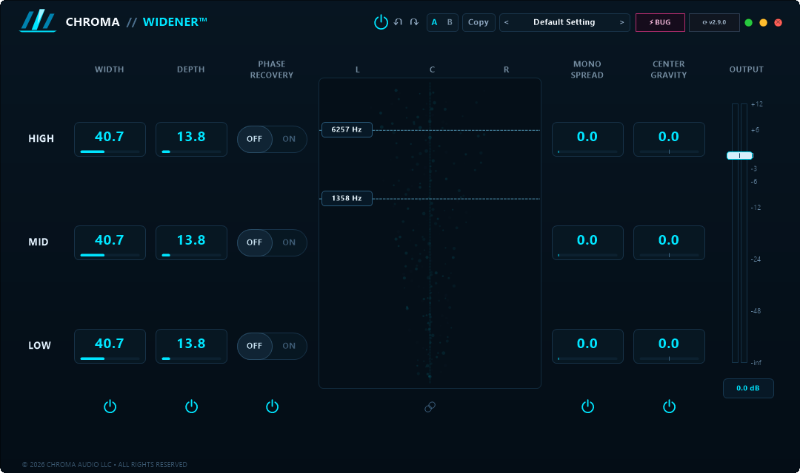
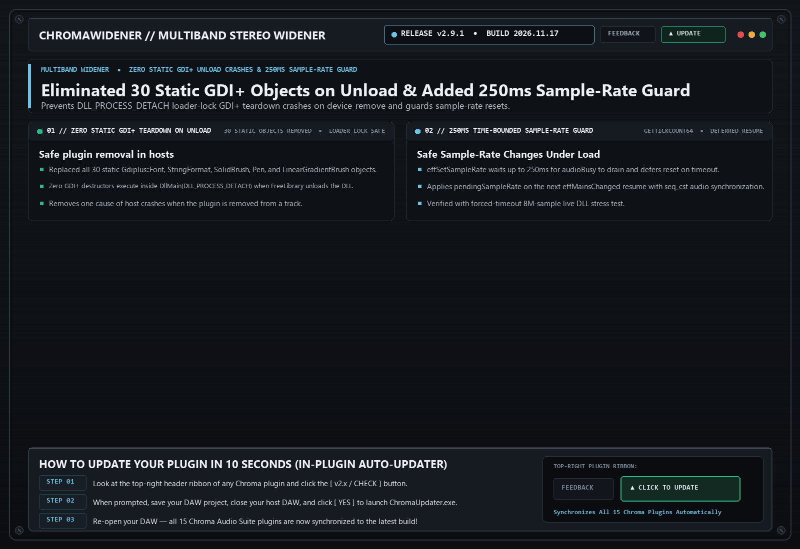

# ChromaWidener (`v2.9.1`)

> **Phase-Safe Multiband Spatializer & Stereo Widener**  
> Expands stereo width across mid and high frequencies while keeping sub-bass anchored and 100% mono-compatible.

### 🎛️ Plugin Interface (`v2.9.1`)

---

## 📚 Tech-to-Music Translator (How It Actually Works in Plain English)

### 🔹 Mid/Side & Decorrelated Stereo Widening (Mono Compatibility)
If you widen a track by simply flipping the phase of one speaker, it sounds super wide in headphones—but the moment it's played on a mono club system or phone speaker, the left and right channels cancel each other out and the sound disappears! Decorrelated multiband widening spreads frequencies above the bass without phase-inverting the center, so your mix sounds huge in stereo and still hits hard in mono.

---

## 🗂️ Version & Patch History

- **[`v2.9.1` (2026-11-17) — Eliminated 30 Static GDI+ Unload Objects & Added 250ms Sample-Rate Guard](./v2.9.1_2026-11-17.md)**
  - **Eliminated All 30 Static GDI+ Objects on Unload**: Replaced every static `Gdiplus::Font`, `StringFormat`, `SolidBrush`, `Pen`, and `LinearGradientBrush` with stack objects so `FreeLibrary` (`device_remove`) never runs GDI+ destructors inside `DllMain(DLL_PROCESS_DETACH)` under the Windows loader lock.
  - **250ms Time-Bounded `effSetSampleRate` Guard + Deferred Resume**: Waits up to `250 ms` for `audioBusy` to drain, defers `widener.Init` on timeout into `pendingSampleRate`, and applies it on the next `effMainsChanged` resume (`seq_cst` synchronized).

- **[`v2.9.0` (2026-11-05) — ChromaAnalogSuite Stability Integration & 1-Click Clipboard [FEEDBACK]](./v2.9.0_2026-11-05.md)**
  - **Per-Channel Analog Tolerance Dispersion & 2x ADAA Stage**: Natural hardware console width with 100% phase-safe mono compatibility.
  - **Phase 2 Optimization (2026-11-15)**: 32-bit DIB cache, `ChromaFastText`, dirty-rect clipping, and idle audio bypass (`0.09%` idle, `2.74 ms` live paint, `0.0/s` idle repaints).
  - **Upgraded 1-Click Clipboard [FEEDBACK] Shield**: Instant `Ctrl+V` diagnostic report copy and pre-filled GitHub Issue.

- **[`v2.8.0` (2026-10-21) — Targeted Dirty-Rect Invalidation, 0.002f Precision & Auto-Updater Shield](./v2.8.0_2026-10-21.md)**
  - **Sub-Safe Stereo Expansion**: Widens synths, vocals, and overheads while keeping low-end punch centered.

---

## 🛠️ Known Issues & Bug Reporting

- A host crash reported by a tester after removing ChromaWidener and ChromaMaster is not yet confirmed by a crash dump.

**Found a bug or weird preset behavior?**  
Click the **`[ FEEDBACK ]`** button in the top-right header of the plugin! It automatically snapshots your patch, EQ curve, and screenshot, copies a diagnostic summary to your Clipboard (`Ctrl+V` ready for Discord), or opens a pre-filled [GitHub Bug Report](https://github.com/haidood/chroma-release/issues/new).
