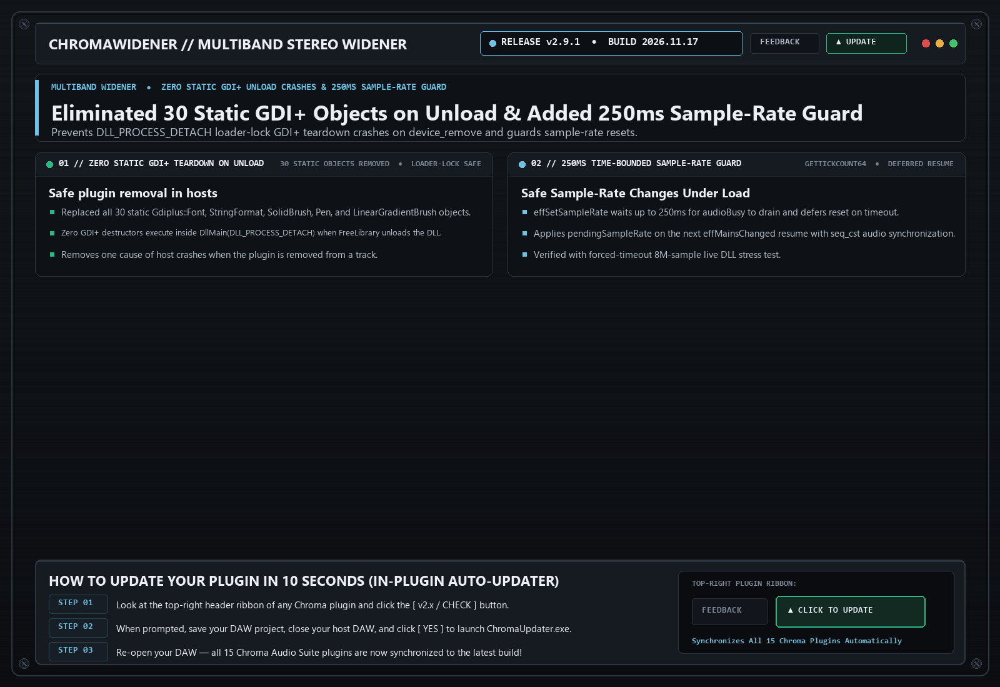

# ChromaWidener `v2.9.1` — Release Notes (2026-11-17)

**[⬅ Back to ChromaWidener Overview & Glossary](./README.md)**

## Eliminated 30 Static GDI+ Unload Objects & Added 250ms Sample-Rate Guard

### What Changed & Why It Matters Musically

- **Eliminated All 30 Static GDI+ Objects on Unload**: Replaced every static `Gdiplus::Font`, `StringFormat`, `SolidBrush`, `Pen`, and `LinearGradientBrush` with stack objects so `FreeLibrary` (`device_remove`) never runs GDI+ destructors inside `DllMain(DLL_PROCESS_DETACH)` under the Windows loader lock.
- **250ms Time-Bounded `effSetSampleRate` Guard + Deferred Resume**: Waits up to `250 ms` for `audioBusy` to drain, defers `widener.Init` on timeout into `pendingSampleRate`, and applies it on the next `effMainsChanged` resume (`seq_cst` synchronized).

---
### ⚡ How to Update in 10 Seconds
1. Click the **`[ v2.x / CHECK ]`** button in the top-right header bar of the plugin.
2. Close your DAW and click **`[ YES ]`** in the prompt to run `ChromaUpdater.exe`.
3. Re-open your DAW — you are now on the latest build!
