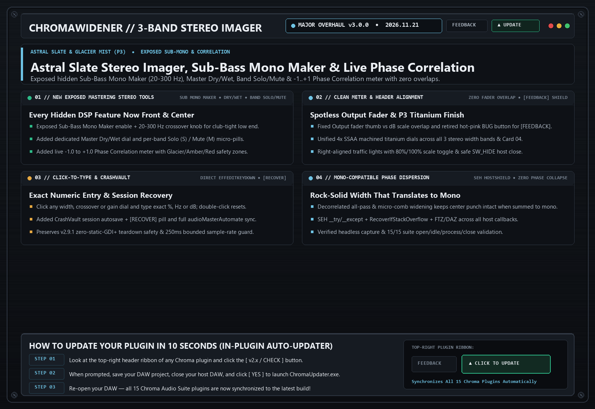

# ChromaWidener `v3.0.0` — Release Notes (2026-11-21)

**[⬅ Back to ChromaWidener Overview & Glossary](./README.md)**

## Astral Slate & Glacier Mist (P3) Imager, Exposed Sub-Bass Mono Maker & Live Phase Correlation

### What Changed & Why It Matters Musically

- **Exposed Hidden Mastering Stereo Controls**: Brought Sub-Bass Mono Maker (`20–300 Hz`), Master Dry/Wet, per-band Solo/Mute (`S`/`M`), and a live `-1.0..+1.0` Phase Correlation meter onto the front panel.
- **Fixed Output Fader Overlap & Upgraded Header**: Eliminated Output fader thumb/scale collisions, replaced the hot-pink BUG button with `[FEEDBACK]`, and unified all controls on 4x SSAA machined titanium dials.
- **250ms Sample-Rate Guard, Click-to-Type & SEH HostShield**: Preserves v2.9.1 zero-static-GDI+ teardown safety and time-bounded sample-rate guard, plus Click-to-Type, CrashVault `[RECOVER]`, and safe `SW_HIDE` close.

---
### ⚡ How to Update in 10 Seconds
1. Click the **`[ v2.x / CHECK ]`** button in the top-right header bar of the plugin.
2. Close your DAW and click **`[ YES ]`** in the prompt to run `ChromaUpdater.exe`.
3. Re-open your DAW — you are now on the latest build!
