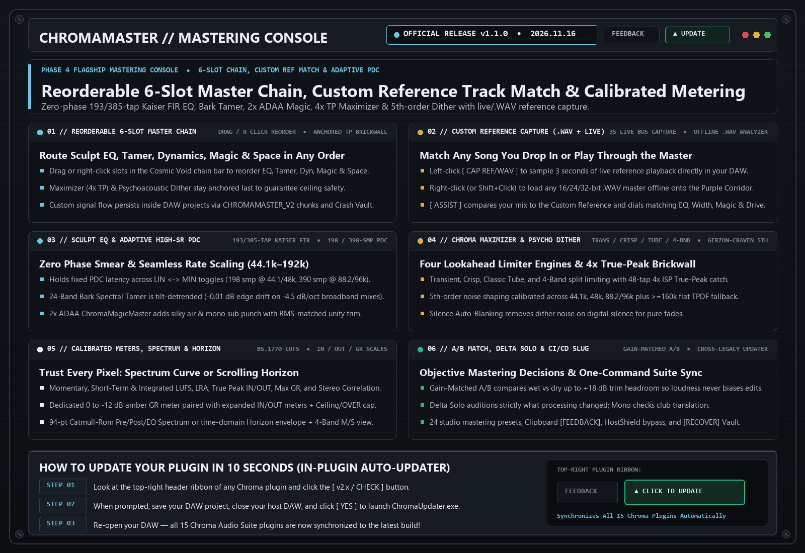

# ChromaMaster (`v1.1.0`)

> **Whole-Song Mastering Workstation (Reorderable 6-Slot Chain, Custom Ref Match, Lin-Phase EQ, Bark Tamer & 4x TP)**  
> Complete mastering console with reorderable 6-slot chain (Sculpt EQ, Bark Tamer, 4-Band Leveler, 2x ADAA Magic, Space/Sub, anchored 4x TP Maximizer), live & .WAV Custom Reference Track Match, 193/385-tap Kaiser Linear-Phase EQ, and 5th-order Psychoacoustic Dither.

### 🎛️ Plugin Interface (`v1.1.0`)

---

## 📚 Tech-to-Music Translator (How It Actually Works in Plain English)

### 🔹 193-Tap Kaiser Linear-Phase vs. Minimum-Phase EQ (Zero PDC Jump)
Traditional analog-style (minimum-phase) EQs curve phase around boosted frequencies, which is musical on instruments but can subtly smear stereo transients during mastering. Linear-phase FIR filtering aligns every frequency band in time with exact zero phase distortion. ChromaMaster holds delay fixed at 198 samples across both modes so toggling LIN FIR on or off mid-session never knocks your DAW tracks out of sync.

### 🔹 24-Band Bark Spectral Tamer (Log-Frequency Tilt Detrended)
Rather than squashing warm, bass-heavy mixes with an ordinary multiband compressor, ChromaMaster subtracts the overall tilt of your song first and measures each auditory Bark band against its neighbors—pulling down only genuinely harsh or resonant peaks while leaving balanced mixes untouched.

### 🔹 4x True-Peak Maximizer & Gerzon-Craven Psychoacoustic Dither
Standard limiters miss intersample peaks that clip between digital samples once converted to analog or AAC/MP3. ChromaMaster checks a 48-tap 4x oversampled signal to clamp true peaks cleanly below your dBTP ceiling, then finishes 24/20/16-bit bounces with sample-rate calibrated psychoacoustic noise shaping and silence auto-blanking.

---

## 🗂️ Version & Patch History

- **[`v1.1.0` (2026-11-16) — Phase 4: Reorderable 6-Slot Master Chain, Custom Reference Capture (.WAV + Live) & High-SR Adaptive PDC](./v1.1.0_2026-11-16.md)**
  - **Reorderable 6-Slot Signal Chain**: Drag or right-click slots in the bottom Cosmic Void rack bar to reorder `SCULPT EQ`, `BARK TAMER`, `4-BND DYN`, `ADAA MAGIC`, and `SPACE / SUB` freely ahead of the anchored `MAXIMIZER (TP)` brickwall (`CHROMAMASTER_V2:` chunk-saved).
  - **Custom Reference Track Capture**: `[ CAP REF/WAV ]` supports both a lock-free 3s live mix capture (`L-Click`) and an offline `.WAV` analyzer (`R-Click`), projecting your custom corridor in purple so `[ ASSIST ]` dials your master toward any reference song.
  - **High-Sample-Rate Adaptive PDC**: Scales FIR + lookahead cleanly (`198` samples @ `44.1/48 kHz`, `390` samples @ `88.2/96 kHz` with 385-tap FIR), updating `initialDelay` strictly on sample-rate change or resume.

- **[`v1.0.0` (2026-11-16) — Initial Release: Cosmic Void Console, 193-Tap Kaiser FIR, Bark Tamer, 4x TP Maximizer & Psycho Dither](./v1.0.0_2026-11-16.md)**
  - **Sculpt EQ & 4-Band Leveler**: 193-tap Kaiser Linear-Phase / Minimum-Phase EQ (`198`-sample fixed PDC, `0.0000 rad` phase error) plus Phase-Matched LR4 4-band leveling and glue.
  - **24-Band Bark Tamer & 2x ADAA Magic Drive**: Equal-ENBW log-frequency tilt detrending (`-0.01 dB` edge drift on `-4.5 dB/oct` mixes) and RMS-matched 2x ADAA air/sub saturation (`-0.04 dB` unity trim, `-0.01 dB` flat to `19 kHz`).
  - **4x True-Peak Maximizer & Psycho Dither**: 4 limiter engines (`TRANS`, `CRISP`, `TUBE`, `4-BND`), 48-tap 4x ISP ceiling protection, 5th-order noise shaping (`44.1k/48k/88.2-96k` + flat TPDF `>=160k`), BS.1770 LUFS, Gain-Matched A/B, Delta Solo, Master Assist, and `[FEEDBACK]` / `[RECOVER]`.

---

## 🛠️ Known Issues & Bug Reporting

- None currently open in v1.1.0.

**Found a bug or weird preset behavior?**  
Click the **`[ FEEDBACK ]`** button in the top-right header of the plugin! It automatically snapshots your patch, EQ curve, and screenshot, copies a diagnostic summary to your Clipboard (`Ctrl+V` ready for Discord), or opens a pre-filled [GitHub Bug Report](https://github.com/haidood/chroma-release/issues/new).
