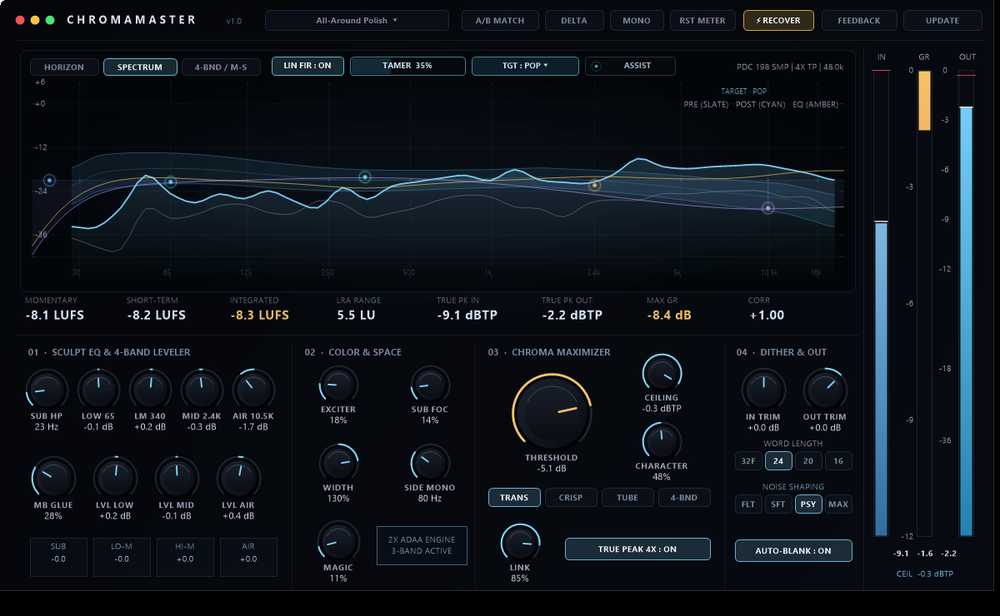
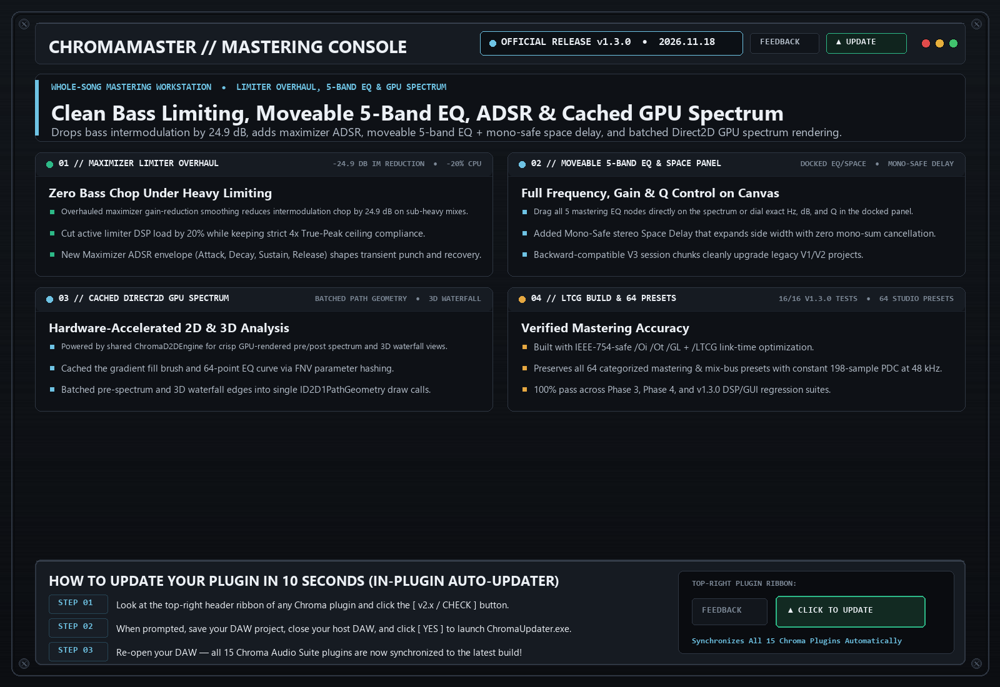

# ChromaMaster (`v1.3.0`)

> **Whole-Song Mastering Workstation (64 Categorized Presets, Reorderable 6-Slot Chain, Custom Ref Match, Lin-Phase EQ, Bark Tamer & 4x TP)**  
> Complete mastering & mix-bus console with a categorized 2-pane browser (64 purpose-built presets across Master, Whole Mix, Drums, Vocals, Synths, Bass, Space & Width, and Mid Scoops), reorderable 6-slot chain, live & .WAV Custom Reference Track Match, 193/385-tap Kaiser Linear-Phase EQ, and 5th-order Psychoacoustic Dither.

### 🎛️ Plugin Interface (`v1.3.0`)

---

## 📚 Tech-to-Music Translator (How It Actually Works in Plain English)

### 🔹 193-Tap Kaiser Linear-Phase vs. Minimum-Phase EQ (Zero PDC Jump)
Traditional analog-style (minimum-phase) EQs curve phase around boosted frequencies, which is musical on instruments but can subtly smear stereo transients during mastering. Linear-phase FIR filtering aligns every frequency band in time with exact zero phase distortion. ChromaMaster holds delay fixed at 198 samples across both modes so toggling LIN FIR on or off mid-session never knocks your DAW tracks out of sync.

### 🔹 24-Band Bark Spectral Tamer (Log-Frequency Tilt Detrended)
Rather than squashing warm, bass-heavy mixes with an ordinary multiband compressor, ChromaMaster subtracts the overall tilt of your song first and measures each auditory Bark band against its neighbors—pulling down only genuinely harsh or resonant peaks while leaving balanced mixes untouched.

### 🔹 4x True-Peak Maximizer & Gerzon-Craven Psychoacoustic Dither
Standard limiters miss intersample peaks that clip between digital samples once converted to analog or AAC/MP3. ChromaMaster checks a 48-tap 4x oversampled signal to clamp true peaks cleanly below your dBTP ceiling, then finishes 24/20/16-bit bounces with sample-rate calibrated psychoacoustic noise shaping and silence auto-blanking.

---

## 🗂️ Version & Patch History

- **[`v1.3.0` (2026-11-18) — Maximizer IM Overhaul, ADSR, Moveable 5-Band EQ, Mono-Safe Space & Cached GPU Spectrum](./v1.3.0_2026-11-18.md)**
  - **Maximizer Limiter Overhaul (-24.9 dB IM Reduction, -20% CPU)**: Eliminated bass intermodulation chop under heavy limiting while adding a full **Maximizer ADSR Envelope** (`Attack`, `Decay`, `Sustain`, `Release`).
  - **Moveable 5-Band Parametric EQ & Mono-Safe Space Panel**: Added draggable frequency, gain, and Q controls across all 5 bands with a docked `EQ/SPACE` panel and a mono-compatible stereo space delay (`7.45e-09` mono-sum invariance).
  - **Cached Direct2D GPU Spectrum & Batched 3D Waterfall**: Upgraded spectrum rendering to `shared/ChromaD2DEngine.h` with cached gradient brush, FNV-cached 64-point EQ curve, batched `ID2D1PathGeometry` traces, and IEEE-754-safe `/Oi /Ot /GL /LTCG` optimization.

- **[`v1.2.0` (2026-11-17) — Categorized 2-Pane Preset Browser & 64 Purpose-Built Mastering / Mix-Bus Presets](./v1.2.0_2026-11-17.md)**
  - **8 Categorized Banks (64 Studio Presets)**: Added a 2-pane Cosmic Obsidian dropdown browser organized into `MASTER`, `WHOLE MIX`, `DRUMS`, `VOCALS`, `SYNTHS`, `BASS`, `SPACE & WIDTH`, and `MID SCOOPS` (8 purpose-built presets each) with a live bottom `ENGINEER'S NOTE` bar explaining the exact mastering theory behind every preset.
  - **Real Mix-Bus & Mastering Theory**: Mix-bus presets default to `32F` (dither off) so bus inserts never add noise; Drum & Bass presets use Minimum-Phase EQ (zero kick/snare pre-ringing); Streaming Clean sets a strict `-1.0 dBTP` True Peak ceiling; and dedicated presets cover Passive Sub-Dip, Warm/Bright Tilts, Mix Widen/Tighten, Tight Low / Wide High, 340Hz Mud Cut, 2.4kHz Harshness Scoop, Vocal-Pocket Carve, Deep V-Shape, and Anti-Scoop Mid Forward.
  - **Per-Preset Optimal 6-Slot Chain Ordering**: Selecting any preset also configures its ideal signal flow (e.g., `Tamer -> EQ -> Dyn` on Vocals, `EQ -> Magic -> Dyn` on Drums, `Dyn -> EQ -> Magic` on Analog Console, `Space -> EQ -> Magic` on Wide Reese & Side-Mud Cleanup) and updates the live chain rack bar.

- **[`v1.1.2` (2026-11-17) — Performance Pass: Static Chrome DIB Cache (2.2 ms Paint), 0.05% Idle CPU & SSE2 True-Peak](./v1.1.2_2026-11-17.md)**
  - **Plain-English Speedup**: The mastering interface now redraws over 7x faster (`2.18–2.41 ms/frame` vs `16.98 ms`), and stopped/silent tracks use virtually zero CPU (`0.05%` vs `5.56%`) while keeping live mastering 28% lighter.
  - **Static 32-Bit DIB Chrome Cache**: Caches the cosmic void gradient, nebula glow, starfield backdrop, all 18 knobs, ticks, and chain rack into a persistent 32-bit DIB (`memcpy` per frame), eliminates per-frame `std::vector` heap allocations and `HasSession` disk stats, and caches the 64-point EQ curve.
  - **SSE2 4x True-Peak, `O(1)` Lookahead & Gated 32-Band Spectrum**: Replaced 12-tap scalar shifts with a mirrored ring + 3-phase SSE2 dot product, replaced the 24-iteration lookahead scan with an exact `O(1)` monotonic deque, eliminated per-sample `log10` and per-block `exp` calls, gated the loop-interchanged 32-band spectrum to active Spectrum/Assist views, and added SSE2 `SymConv` + flat-band bypass in `SymmetricLinearPhaseEq193`.

- **[`v1.1.1` (2026-11-17) — Keep-Running Bypass Crossfade, Dimmed Bypass Meters & Classic Tube Unity Gain Trim](./v1.1.1_2026-11-17.md)**
  - **Keep-Running Wet Chain During Bypass + `2 ms` Crossfade**: The wet mastering chain continues processing while bypassed so FIR, leveler, and limiter histories remain warm, crossfading smoothly over `2 ms` (`bypassMix_`) with zero clicks and bit-exact two-instance parity once settled.
  - **Dimmed/Zeroed Bypass Metering**: Gain reduction, Bark Tamer, and trim meters dim and zero cleanly while bypassed, and `FlushWetState()` runs strictly inside `ResetState()`.
  - **Calibrated `MODE_CLASSIC_TUBE` Unity Gain**: Normalized small-signal clean gain by `1 / (1 + 0.081 * fbDrive)`, matching unity within `-0.0025 dB` at `1 kHz` and `-0.0001 dB` at `19 kHz`.

- **[`v1.1.0` (2026-11-16) — Phase 4: Reorderable 6-Slot Master Chain, Custom Reference Capture (.WAV + Live) & High-SR Adaptive PDC](./v1.1.0_2026-11-16.md)**
  - **Reorderable 6-Slot Signal Chain**: Drag or right-click slots in the bottom Cosmic Void rack bar to reorder `SCULPT EQ`, `BARK TAMER`, `4-BND DYN`, `ADAA MAGIC`, and `SPACE / SUB` freely ahead of the anchored `MAXIMIZER (TP)` brickwall (`CHROMAMASTER_V2:` chunk-saved).
  - **Custom Reference Track Capture**: `[ CAP REF/WAV ]` supports both a lock-free 3s live mix capture (`L-Click`) and an offline `.WAV` analyzer (`R-Click`), projecting your custom corridor in purple so `[ ASSIST ]` dials your master toward any reference song.
  - **High-Sample-Rate Adaptive PDC**: Scales FIR + lookahead cleanly (`198` samples @ `44.1/48 kHz`, `390` samples @ `88.2/96 kHz` with 385-tap FIR), updating `initialDelay` strictly on sample-rate change or resume.

- **[`v1.0.0` (2026-11-16) — Initial Release: Cosmic Void Console, 193-Tap Kaiser FIR, Bark Tamer, 4x TP Maximizer & Psycho Dither](./v1.0.0_2026-11-16.md)**
  - **Sculpt EQ & 4-Band Leveler**: 193-tap Kaiser Linear-Phase / Minimum-Phase EQ (`198`-sample fixed PDC, `0.0000 rad` phase error) plus Phase-Matched LR4 4-band leveling and glue.
  - **24-Band Bark Tamer & 2x ADAA Magic Drive**: Equal-ENBW log-frequency tilt detrending (`-0.01 dB` edge drift on `-4.5 dB/oct` mixes) and RMS-matched 2x ADAA air/sub saturation (`-0.04 dB` unity trim, `-0.01 dB` flat to `19 kHz`).
  - **4x True-Peak Maximizer & Psycho Dither**: 4 limiter engines (`TRANS`, `CRISP`, `TUBE`, `4-BND`), 48-tap 4x ISP ceiling protection, 5th-order noise shaping (`44.1k/48k/88.2-96k` + flat TPDF `>=160k`), BS.1770 LUFS, Gain-Matched A/B, Delta Solo, Master Assist, and `[FEEDBACK]` / `[RECOVER]`.

---

## 🛠️ Known Issues & Bug Reporting

- A host crash reported by a tester is not yet confirmed by a crash dump.

**Found a bug or weird preset behavior?**  
Click the **`[ FEEDBACK ]`** button in the top-right header of the plugin! It automatically snapshots your patch, EQ curve, and screenshot, copies a diagnostic summary to your Clipboard (`Ctrl+V` ready for Discord), or opens a pre-filled [GitHub Bug Report](https://github.com/haidood/chroma-release/issues/new).
