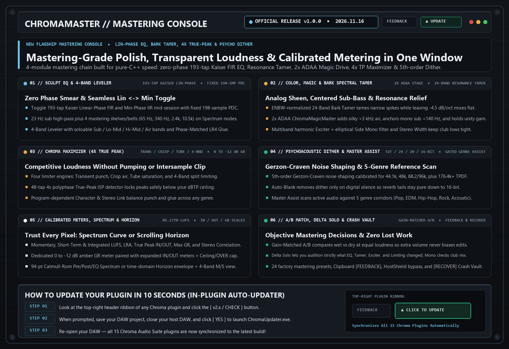

# ChromaMaster `v1.0.0` — Release Notes (2026-11-16)

**[⬅ Back to ChromaMaster Overview & Glossary](./README.md)**

## Initial Release: Cosmic Void Console, 193-Tap Kaiser FIR, Bark Tamer, 4x TP Maximizer & Psycho Dither

### What Changed & Why It Matters Musically

- **Sculpt EQ & 4-Band Leveler**: 193-tap Kaiser Linear-Phase / Minimum-Phase EQ (`198`-sample fixed PDC, `0.0000 rad` phase error) plus Phase-Matched LR4 4-band leveling and glue.
- **24-Band Bark Tamer & 2x ADAA Magic Drive**: Equal-ENBW log-frequency tilt detrending (`-0.01 dB` edge drift on `-4.5 dB/oct` mixes) and RMS-matched 2x ADAA air/sub saturation (`-0.04 dB` unity trim, `-0.01 dB` flat to `19 kHz`).
- **4x True-Peak Maximizer & Psycho Dither**: 4 limiter engines (`TRANS`, `CRISP`, `TUBE`, `4-BND`), 48-tap 4x ISP ceiling protection, 5th-order noise shaping (`44.1k/48k/88.2-96k` + flat TPDF `>=160k`), BS.1770 LUFS, Gain-Matched A/B, Delta Solo, Master Assist, and `[FEEDBACK]` / `[RECOVER]`.

---
### ⚡ How to Update in 10 Seconds
1. Click the **`[ v2.x / CHECK ]`** button in the top-right header bar of the plugin.
2. Close your DAW and click **`[ YES ]`** in the prompt to run `ChromaUpdater.exe`.
3. Re-open your DAW — you are now on the latest build!
