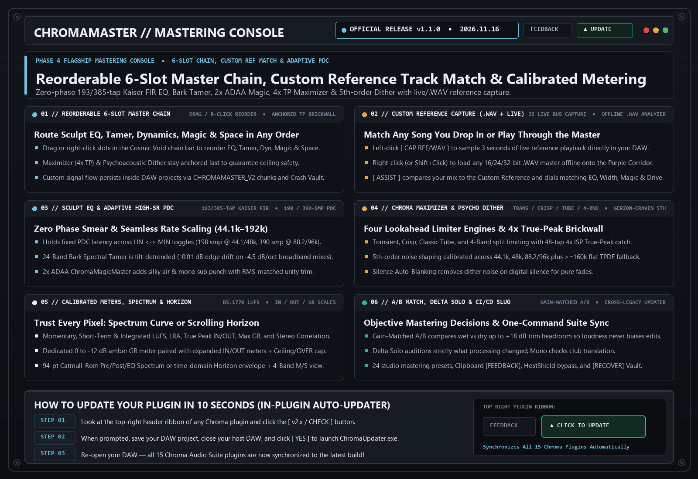

# ChromaMaster `v1.1.0` — Release Notes (2026-11-16)

**[⬅ Back to ChromaMaster Overview & Glossary](./README.md)**

## Phase 4: Reorderable 6-Slot Master Chain, Custom Reference Capture (.WAV + Live) & High-SR Adaptive PDC

### What Changed & Why It Matters Musically

- **Reorderable 6-Slot Signal Chain**: Drag or right-click slots in the bottom Cosmic Void rack bar to reorder `SCULPT EQ`, `BARK TAMER`, `4-BND DYN`, `ADAA MAGIC`, and `SPACE / SUB` freely ahead of the anchored `MAXIMIZER (TP)` brickwall (`CHROMAMASTER_V2:` chunk-saved).
- **Custom Reference Track Capture**: `[ CAP REF/WAV ]` supports both a lock-free 3s live mix capture (`L-Click`) and an offline `.WAV` analyzer (`R-Click`), projecting your custom corridor in purple so `[ ASSIST ]` dials your master toward any reference song.
- **High-Sample-Rate Adaptive PDC**: Scales FIR + lookahead cleanly (`198` samples @ `44.1/48 kHz`, `390` samples @ `88.2/96 kHz` with 385-tap FIR), updating `initialDelay` strictly on sample-rate change or resume.

---
### ⚡ How to Update in 10 Seconds
1. Click the **`[ v2.x / CHECK ]`** button in the top-right header bar of the plugin.
2. Close your DAW and click **`[ YES ]`** in the prompt to run `ChromaUpdater.exe`.
3. Re-open your DAW — you are now on the latest build!
