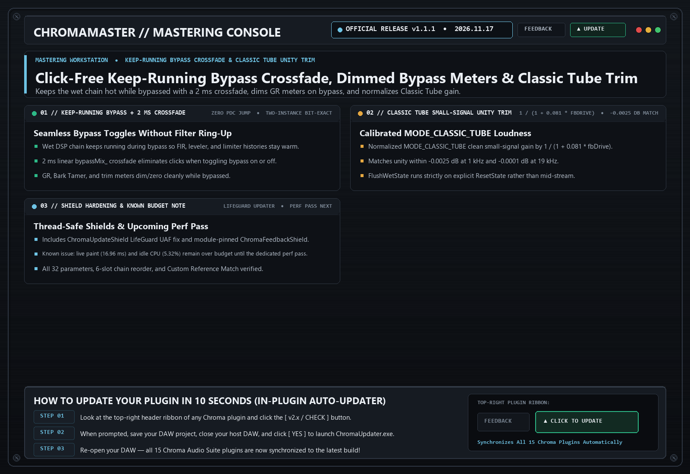

# ChromaMaster `v1.1.1` — Release Notes (2026-11-17)

**[⬅ Back to ChromaMaster Overview & Glossary](./README.md)**

## Keep-Running Bypass Crossfade, Dimmed Bypass Meters & Classic Tube Unity Gain Trim

### What Changed & Why It Matters Musically

- **Keep-Running Wet Chain During Bypass + `2 ms` Crossfade**: The wet mastering chain continues processing while bypassed so FIR, leveler, and limiter histories remain warm, crossfading smoothly over `2 ms` (`bypassMix_`) with zero clicks and bit-exact two-instance parity once settled.
- **Dimmed/Zeroed Bypass Metering**: Gain reduction, Bark Tamer, and trim meters dim and zero cleanly while bypassed, and `FlushWetState()` runs strictly inside `ResetState()`.
- **Calibrated `MODE_CLASSIC_TUBE` Unity Gain**: Normalized small-signal clean gain by `1 / (1 + 0.081 * fbDrive)`, matching unity within `-0.0025 dB` at `1 kHz` and `-0.0001 dB` at `19 kHz`.

---
### ⚡ How to Update in 10 Seconds
1. Click the **`[ v2.x / CHECK ]`** button in the top-right header bar of the plugin.
2. Close your DAW and click **`[ YES ]`** in the prompt to run `ChromaUpdater.exe`.
3. Re-open your DAW — you are now on the latest build!
