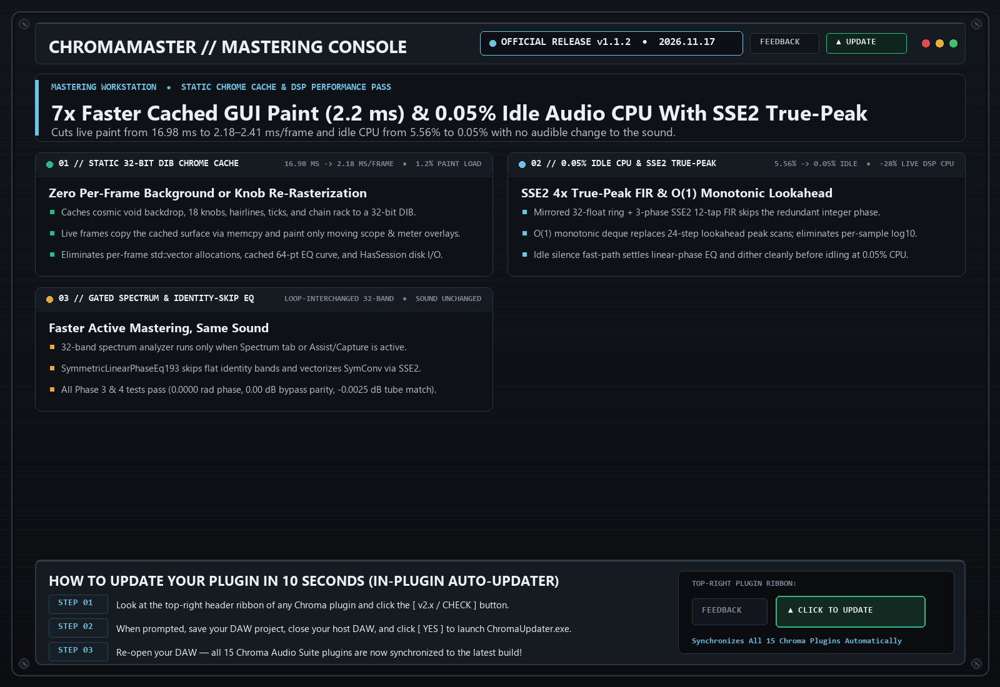

# ChromaMaster `v1.1.2` — Release Notes (2026-11-17)

**[⬅ Back to ChromaMaster Overview & Glossary](./README.md)**

## Performance Pass: Static Chrome DIB Cache (2.2 ms Paint), 0.05% Idle CPU & SSE2 True-Peak

### What Changed & Why It Matters Musically

- **Plain-English Speedup**: The mastering interface now redraws over 7x faster (`2.18–2.41 ms/frame` vs `16.98 ms`), and stopped/silent tracks use virtually zero CPU (`0.05%` vs `5.56%`) while keeping live mastering 28% lighter.
- **Static 32-Bit DIB Chrome Cache**: Caches the cosmic void gradient, nebula glow, starfield backdrop, all 18 knobs, ticks, and chain rack into a persistent 32-bit DIB (`memcpy` per frame), eliminates per-frame `std::vector` heap allocations and `HasSession` disk stats, and caches the 64-point EQ curve.
- **SSE2 4x True-Peak, `O(1)` Lookahead & Gated 32-Band Spectrum**: Replaced 12-tap scalar shifts with a mirrored ring + 3-phase SSE2 dot product, replaced the 24-iteration lookahead scan with an exact `O(1)` monotonic deque, eliminated per-sample `log10` and per-block `exp` calls, gated the loop-interchanged 32-band spectrum to active Spectrum/Assist views, and added SSE2 `SymConv` + flat-band bypass in `SymmetricLinearPhaseEq193`.

---
### ⚡ How to Update in 10 Seconds
1. Click the **`[ v2.x / CHECK ]`** button in the top-right header bar of the plugin.
2. Close your DAW and click **`[ YES ]`** in the prompt to run `ChromaUpdater.exe`.
3. Re-open your DAW — you are now on the latest build!
