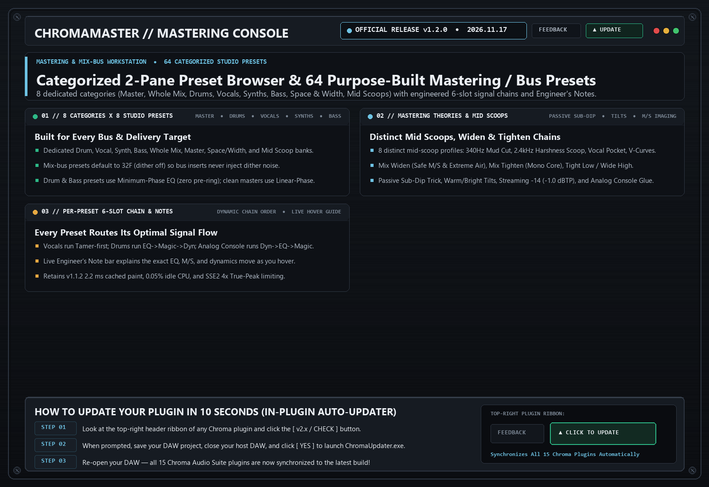

# ChromaMaster `v1.2.0` — Release Notes (2026-11-17)

**[⬅ Back to ChromaMaster Overview & Glossary](./README.md)**

## Categorized 2-Pane Preset Browser & 64 Purpose-Built Mastering / Mix-Bus Presets

### What Changed & Why It Matters Musically

- **8 Categorized Banks (64 Studio Presets)**: Added a 2-pane Cosmic Obsidian dropdown browser organized into `MASTER`, `WHOLE MIX`, `DRUMS`, `VOCALS`, `SYNTHS`, `BASS`, `SPACE & WIDTH`, and `MID SCOOPS` (8 purpose-built presets each) with a live bottom `ENGINEER'S NOTE` bar explaining the exact mastering theory behind every preset.
- **Real Mix-Bus & Mastering Theory**: Mix-bus presets default to `32F` (dither off) so bus inserts never add noise; Drum & Bass presets use Minimum-Phase EQ (zero kick/snare pre-ringing); Streaming Clean sets a strict `-1.0 dBTP` True Peak ceiling; and dedicated presets cover Passive Sub-Dip, Warm/Bright Tilts, Mix Widen/Tighten, Tight Low / Wide High, 340Hz Mud Cut, 2.4kHz Harshness Scoop, Vocal-Pocket Carve, Deep V-Shape, and Anti-Scoop Mid Forward.
- **Per-Preset Optimal 6-Slot Chain Ordering**: Selecting any preset also configures its ideal signal flow (e.g., `Tamer -> EQ -> Dyn` on Vocals, `EQ -> Magic -> Dyn` on Drums, `Dyn -> EQ -> Magic` on Analog Console, `Space -> EQ -> Magic` on Wide Reese & Side-Mud Cleanup) and updates the live chain rack bar.

---
### ⚡ How to Update in 10 Seconds
1. Click the **`[ v2.x / CHECK ]`** button in the top-right header bar of the plugin.
2. Close your DAW and click **`[ YES ]`** in the prompt to run `ChromaUpdater.exe`.
3. Re-open your DAW — you are now on the latest build!
