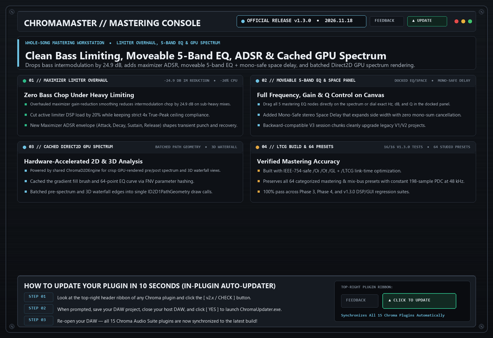

# ChromaMaster `v1.3.0` — Release Notes (2026-11-18)

**[⬅ Back to ChromaMaster Overview & Glossary](./README.md)**

## Maximizer IM Overhaul, ADSR, Moveable 5-Band EQ, Mono-Safe Space & Cached GPU Spectrum

### What Changed & Why It Matters Musically

- **Maximizer Limiter Overhaul (-24.9 dB IM Reduction, -20% CPU)**: Eliminated bass intermodulation chop under heavy limiting while adding a full **Maximizer ADSR Envelope** (`Attack`, `Decay`, `Sustain`, `Release`).
- **Moveable 5-Band Parametric EQ & Mono-Safe Space Panel**: Added draggable frequency, gain, and Q controls across all 5 bands with a docked `EQ/SPACE` panel and a mono-compatible stereo space delay (`7.45e-09` mono-sum invariance).
- **Cached Direct2D GPU Spectrum & Batched 3D Waterfall**: Upgraded spectrum rendering to `shared/ChromaD2DEngine.h` with cached gradient brush, FNV-cached 64-point EQ curve, batched `ID2D1PathGeometry` traces, and IEEE-754-safe `/Oi /Ot /GL /LTCG` optimization.

### ⌨️ Hotkey & Gesture Quick Reference

| Key / Gesture | Action | Description |
|---|---|---|
| `Click Knob -> Type Number + Enter` | **Exact Numeric Value Entry** | Click any mastering dial (Threshold, Ceiling, Space Mix, EQ Gain/Freq), type exact dB/Hz/% and press Enter (`Esc` cancels). |
| `Drag / Double-Click EQ Node` | **5-Band Moveable Parametric EQ** | Double-click on the GPU spectrum to toggle/add bands, drag Freq/Gain freely, and scroll wheel to sculpt Q bandwidth. |
| `Shift + Drag / Fine Wheel` | **0.1 dB Precision Mastering Trim** | Hold `Shift` while dragging knobs or faders for razor-fine mastering ceiling and output trim adjustments. |
| `Click [ LIN <-> MIN ] / Chain Slots` | **Zero-PDC Toggle & 6-Slot Flow** | Audition Linear-Phase Kaiser FIR vs. Minimum-Phase live without PDC jumps, or reorder the 6 mastering modules cleanly. |
| `Double-Click / Right-Click Knob` | **Reset to Unity / Default** | Instantly resets any knob or fader back to its mastering default. |

---
### ⚡ How to Update in 10 Seconds
1. Click the **`[ v2.x / CHECK ]`** button in the top-right header bar of the plugin.
2. Close your DAW and click **`[ YES ]`** in the prompt to run `ChromaUpdater.exe`.
3. Re-open your DAW — you are now on the latest build!
